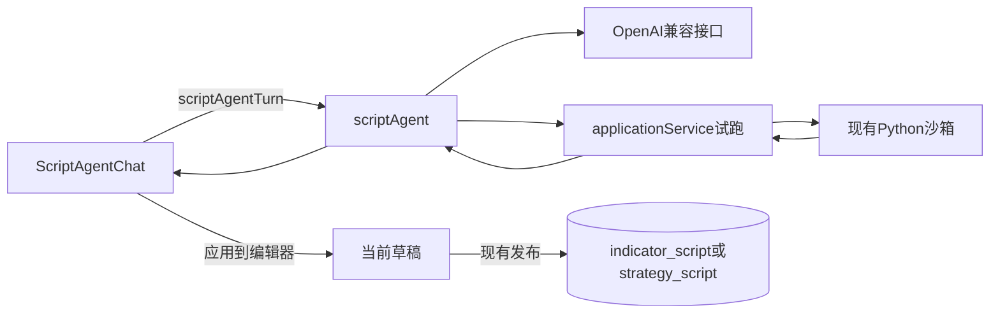

# Sprint10 迭代文档

> 版本：v0.3.10
> 状态：**进行中**
> 关联：[Sprint9 迭代文档](../Sprint9/迭代文档.md)、[Script 系统架构](../../v0.2/Script系统架构.md)

本迭代把脚本助手定为图表脚本编辑器的正式能力。用户用一句话生成当前草稿种类的指标或策略源码，现有试跑通过后才写入草稿，发布仍用原来的按钮。通达信公式翻译不在本迭代，也不作为后续目标。

---

## 1. 当前迭代目标

在现有指标、策略方言和试跑之上，提供对话生成脚本。助手只产出源码，不另开执行通道，也不写入脚本库。

### 1.1 目标声明

| # | 目标 | 验收口径 |
|---|---|---|
| G1 | 配置页可以保存一家 OpenAI 兼容服务 | 保存 Base URL、模型名和 API Key 后，页顶与「脚本助手」卡片都显示已配置。渲染进程只能看到是否已配置，拿不到明文 Key |
| G2 | 对话生成的源码必须先过现有试跑 | 指标走 `tryIndicatorScript`，策略走 `tryStrategyScript`，并带上编辑器当前的行情查询。失败时把错误和行号交回模型，最多 3 轮 |
| G3 | 通过后由用户决定是否写入草稿 | 对话里出现「应用到编辑器」。点击后只更新当前草稿的标题和源码，不调用创建或更新接口 |
| G4 | 失败不覆盖手写草稿 | 未配置、超时、密钥错误、三轮仍失败时，编辑器源码保持发送前的内容，对话里写明原因 |
| G5 | 助手不可用时，编辑器其余能力仍在 | 断网或未配置时，仍可手写、执行和发布 |

### 1.2 范围边界（本迭代不做）

- 不把通达信公式翻译成 Python，也不为对齐通达信增加 `SMA`、`REF`、`HHV` 等序列函数
- 不自动发布，不在试跑通过后直接入库
- 不做逐字流式输出。一次对话等整段回环结束后再显示
- 不把对话写入 SQLite。换草稿（`draft.id` 变化）或切换指标/策略时，会话清空
- 不在对话里切换脚本种类。种类以当前草稿为准
- 不做自动调参，不把 K 线放进提示词
- 不改 Python 沙箱、worker 协议和脚本表结构

### 1.3 技术选型（本迭代）

| 层 | 选型 |
|---|---|
| 壳 / 构建 | 现有 Electron。模型请求放在主进程 |
| UI | 脚本编辑器右下角一个图标。未配置时不可点，悬停说明原因。点击后从底部展开对话。配置放在现有配置页 |
| 业务 | 主进程编排「生成 → 试跑 → 最多修 3 轮」。试跑复用 `applicationService` 已有方法 |
| 数据 / 计算 | Base URL 与模型名写入 `userData/config/config.json`。API Key 用 Electron `safeStorage` 写到 `userData/config/script-agent.key`。环境变量 `SCRIPT_AGENT_API_KEY` 优先于本地文件 |
| 协议 | 新增 IPC `config:getScriptAgent`、`config:setScriptAgent`、`scriptAgent:turn`，进度事件 `scriptAgent:progress`。脚本执行仍走原来的 `indicatorScript:try` 与 `strategyScript:try` |

---

## 2. 功能需求

### 2.1 用户故事

1. 作为用户，我在配置页填入 OpenAI 兼容接口的地址、模型名和密钥，之后界面只告诉我已经配置。
2. 作为用户，我在指标草稿里描述一个副图指标，助手给出能试跑通过的源码，我确认后才放进编辑器。
3. 作为用户，我在策略草稿里描述买卖条件，对话里能看到试跑的买入、卖出和 K 线根数，源码不会自动入库。
4. 作为用户，生成失败或我还没点应用时，编辑器里原来的脚本还在，我可以继续手改并发布。
5. 作为用户，我换一份脚本或从指标换成策略时，上一段对话不再留在面板上。

### 2.2 功能清单

| ID | 功能 | 优先级 | 状态 |
|---|---|---|---|
| F01 | 脚本助手配置：地址、模型名、加密密钥 | P0 | 已完成 |
| F02 | 方言提示，附带现有均线与突破策略示例 | P0 | 已完成 |
| F03 | 生成、试跑、最多 3 轮修复 | P0 | 已完成 |
| F04 | `scriptAgent:turn` 与进度事件 | P0 | 已完成 |
| F05 | 右下角图标展开对话，应用到当前草稿 | P0 | 已完成 |
| F06 | 未配置时禁用发送，编辑器其余按钮保持可用 | P0 | 已完成 |

### 2.3 非功能需求

- API Key 不进入 `config.json`，也不出现在 `ScriptAgentPublicConfig` 里
- 单次模型请求 60 秒超时。生成源码超过 32KB 不送去试跑
- 模型输出不是含 `assistant`、`title`、`source` 的 JSON 时，本轮不试跑，进入修复
- 助手不能调用脚本的创建、更新、删除
- 行情窗口为空（错误含「没有K线」）或子进程没有输出时，停止修复，避免把数据问题当成源码问题反复改
- 发送后换草稿，迟到的结果不再写入新会话

---

## 3. 详细设计说明

### 3.1 进程与数据流



渲染进程只提交当前种类、标题、源码、最近对话，以及编辑器已有的行情查询。主进程组提示词、调模型、再调用 `tryIndicatorScript` 或 `tryStrategyScript`。Python worker 不知道这次源码来自对话。

### 3.2 目录 / 模块（本迭代涉及）

```
src/shared/types/scriptAgent.ts
src/main/config/appConfig.ts
src/main/config/scriptAgentSecret.ts
src/main/agent/chatUrl.ts
src/main/agent/dialect.ts
src/main/agent/llmClient.ts
src/main/agent/scriptAgentLoop.ts
src/main/agent/scriptAgent.ts
src/main/ipc/registerHandlers.ts
src/main/index.ts
src/preload/index.ts
src/preload/index.d.ts
src/renderer/src/pages/SettingsPage.tsx
src/renderer/src/pages/chart/scriptEditor/ScriptAgentChat.tsx
src/renderer/src/pages/chart/scriptEditor/ScriptEditorPanel.tsx
```

### 3.3 数据模型 / 存储

`config.json` 增加两个非密钥字段：

- `scriptAgentBaseUrl`
- `scriptAgentModel`

密钥文件是 `userData/config/script-agent.key`，内容为 `safeStorage.encryptString` 的二进制。读取顺序是环境变量 `SCRIPT_AGENT_API_KEY`，然后才是该文件。加密不可用时拒绝写入，并提示「当前系统无法加密保存密钥」。

对话不落库。会话只存在 `ScriptAgentChat` 的组件状态中。

### 3.4 协议 / API / IPC

`config:getScriptAgent` 返回：

```json
{ "baseUrl": "", "model": "", "hasApiKey": false }
```

`config:setScriptAgent` 接收 `baseUrl`、`model`，以及可选的 `apiKey`。地址必须是 `http` 或 `https`。密钥留空时保留已有密钥或环境变量。返回形状与读取相同，不含明文。

`scriptAgent:turn` 请求：

| 字段 | 含义 |
|---|---|
| `kind` | `indicator` 或 `strategy`，必须与当前草稿一致 |
| `title` | 当前标题，截断到 200 字 |
| `source` | 当前源码，作为本轮事实来源 |
| `messages` | 最近 8 条。最后一条必须是用户发言，单条正文截断到 8000 字 |
| `query` | 可选。有值时沿用 `indicatorScript:try` 的行情查询解析 |

响应 `ScriptAgentTurnResult`：`ok`、`assistant`、`title`、`source`、`rounds`、`tryResult`、`error`。失败时 `source` 为空字符串，因此界面不会给出应用按钮。

进度事件 `scriptAgent:progress`：`phase` 为 `generate` 或 `repair`，`round` 从 1 开始。界面在第 1 轮显示「正在生成」，之后显示「正在按试跑结果修改（第 n 轮）」。

模型地址由 `chatCompletionsUrl` 拼出：已带 `/chat/completions` 则原样使用；以 `/v1` 结尾则补上该路径；否则在末尾加上 `/v1/chat/completions`。请求为非流式 Chat Completions，`temperature` 为 0.2。对方拒绝 `response_format: json_object` 时，去掉该字段重试一次。

### 3.5 核心编排

`runScriptAgentTurn` 的步骤：

1. 用 `scriptAgentSetupError` 检查地址、模型名和密钥。缺任一项则直接返回，不读示例、不请求模型。
2. `buildDialectPrompt` 写入指标与策略规则，并附上 `readExampleMaSource()`、`readExampleStrategySource()` 的原文。
3. `runScriptAgentLoop` 最多 3 轮。系统提示之后只保留此前最多 6 条对话，再附上当前种类、标题、源码和本轮需求。
4. 解析 JSON。允许模型外面包一层 Markdown 代码块。缺少非空 `source` 时不试跑。
5. 源码 UTF-8 超过 32KB 时要求缩短，不调用试跑。
6. 按种类调用 `applicationService.tryIndicatorScript` 或 `tryStrategyScript`。有行情查询就带上。
7. 试跑成功则返回源码和 `tryResult`。失败则把错误、行号、列号和截断后的 traceback 送回下一轮。
8. 错误文本包含「没有K线」或 `script produced no output` 时立刻结束。

### 3.6 UI

配置页「脚本助手」卡片包含 Base URL、模型名、密码框和保存按钮。密钥已存在时，密码框留空表示不修改。页顶芯片与卡片芯片共用「已配置 / 未配置」。判定与 `scriptAgentSetupError` 相同：地址、模型名、密钥三者都有才算已配置。

脚本编辑器仍是图表页右侧面板。Monaco 在上，高度至少 120。默认只在右下角放一个图标按钮。地址、模型名、密钥三者缺一时按钮不可用，悬停出现「请先到配置页填写脚本助手的 Base URL、模型名和 API Key」。配置齐全后点击，对话从底部展开，高度 280，样式与展开前设计的对话区相同。标题栏可以收起。输入框在生成中或编辑器正忙时不可发送。

应用按钮调用 `onDraftChange`，标题为空时保留原标题，并清掉编辑器上一次试跑提示。对话追加「已写入编辑器草稿，尚未发布。」用户之后仍点原有的执行和发布。

### 3.7 契约

| 层级 | 位置 |
|---|---|
| TypeScript | `src/shared/types/scriptAgent.ts` |
| 预加载 | `src/preload/index.ts`、`src/preload/index.d.ts` 的 `config.getScriptAgent`、`config.setScriptAgent`、`scriptAgent.turn`、`scriptAgent.onProgress` |
| Python | 无新增。试跑仍是 `compute.script_try` 与 `strategy.script_try` |

---

## 4. 任务步骤

| 步骤 | 任务 | 产出 | 状态 |
|---|---|---|---|
| 1 | 配置项与密钥文件 | `appConfig.ts`、`scriptAgentSecret.ts`，启动时 `initScriptAgentSecret` | 已完成 |
| 2 | 方言提示与模型客户端 | `dialect.ts`、`chatUrl.ts`、`llmClient.ts` | 已完成 |
| 3 | 试跑修复回环 | `scriptAgentLoop.ts`、`scriptAgent.ts` | 已完成 |
| 4 | IPC 与预加载 | `registerHandlers.ts`、`preload/index.ts`、`preload/index.d.ts` | 已完成 |
| 5 | 配置页与编辑器对话 | `SettingsPage.tsx`、`ScriptAgentChat.tsx`、`ScriptEditorPanel.tsx` | 已完成 |
| 6 | 类型检查，并在窗口里走通真实模型 | `npm run typecheck`；配置、指标、策略、失败、断网五条路径 | 类型检查已完成；窗口路径待补跑 |

### 4.1 本地复现命令

```bash
npm run typecheck
npm run dev
```

窗口验收前，在配置页保存 Base URL、模型名和 API Key，或设置环境变量 `SCRIPT_AGENT_API_KEY`。策略路径需要当前图表已有可试跑的行情查询。

---

## 5. 测试结果 / 总结反馈

### 5.1 验收清单与结果

| 检查项 | 方式 | 结果 | 说明 |
|---|---|---|---|
| G1 配置保存后渲染进程看不到明文 Key | 对照 `ScriptAgentPublicConfig` 与 `config:getScriptAgent` | 通过 | 返回只有 `baseUrl`、`model`、`hasApiKey`。密钥读写只在主进程 |
| G2–G4 回环：一次通过、策略计数、非法写法修复、三轮失败不改草稿、密钥错误不试跑 | 开发时临时脚本调用 `runScriptAgentLoop` | 通过 | 2026-10-31 跑通后脚本已删除，仓库里没有对应命令，不能重复执行 |
| 未配置时 `scriptAgentSetupError` 拒绝生成 | 同上，对空地址和缺密钥各查一次 | 通过 | 与界面禁用发送使用同一函数 |
| `npm run typecheck` | 命令 | 通过 | 2026-10-31，`typecheck:node` 与 `typecheck:web` 均退出码 0 |
| 配置页保存后芯片变为已配置 | 窗口手工 | 待补跑 | 需要在开发窗口里保存一次 |
| 指标「副图 RSI」应用后，点现有发布能出现在指标列表 | 窗口手工，需真实模型 | 待补跑 | 需要可用的兼容接口和密钥 |
| 策略突破条件的试跑带买入、卖出计数，且不自动入库 | 窗口手工，需真实模型与行情 | 待补跑 | 无查询时策略试跑只校验声明，计数依赖当前图表查询 |
| 主图 `yrange` 失败时原草稿仍在 | 窗口手工 | 待补跑 | 回环逻辑已在临时脚本里见过，窗口尚未点过 |
| 断网或错误密钥时仍可手写、试跑、发布 | 窗口手工 | 待补跑 | 助手失败路径不调用编辑器的写入 |

### 5.2 关键命令记录

```
npm run typecheck
typecheck:node  通过
typecheck:web   通过
退出码 0
```

临时回环脚本的结论：指标源码一次试跑通过；策略结果保留 `buy_count`；主图 `yrange` 的错误进入第 2 轮修复；连续 3 次失败时响应 `source` 为空；HTTP 401 不会调用试跑。该脚本没有留在仓库中。

### 5.3 总结反馈

**做得好的地方**

- 助手接在现有试跑前面，脚本库的写入仍然只有用户点击发布
- 密钥和提示词都留在主进程，渲染进程只拿公开配置和最终源码
- 空行情窗口和 worker 无输出会停止修复，不会把数据问题消耗成 3 轮改写

**暴露的问题 / 摩擦**

- 回环检查没有变成仓库里的命令，换一台机器无法复现那次核对
- 真实模型、配置页芯片和发布列表都还没有在开发窗口里点过
- 策略在没有当前行情查询时，试跑可以只验证参数声明，对话里不会出现买卖计数

---

## 6. 改进目标

### 6.1 短期（下一迭代可做）

1. 把回环检查留在仓库里，覆盖一次通过、修复、三轮失败、密钥错误和未配置
2. 在开发窗口补完配置保存、指标发布、策略计数、失败不覆盖、断网仍可发布
3. 没有行情查询时，策略对话先说明当前只能检查参数声明

### 6.2 中期

1. 按脚本 id 在本地记住对话，换草稿后再回来仍能看到上一轮说明
2. 说明文字可以逐段显示。源码仍然等试跑通过后一次给出
3. 生成过程允许取消，取消后草稿保持原样

### 6.3 长期

1. 助手可以解释某次试跑失败，并指出应该改的行，而不另开一种执行方式
2. 在用户明确要求时，才根据试跑统计帮助改参数。参数修改仍要经过现有试跑和发布

---

## 附录

### A. 相关文档

- [Sprint9 迭代文档](../Sprint9/迭代文档.md)
- [Script 系统架构](../../v0.2/Script系统架构.md)

### B. 常用命令

| 命令 | 用途 |
|---|---|
| `npm run dev` | 开发起窗 |
| `npm run typecheck` | 主进程与渲染进程类型检查 |
