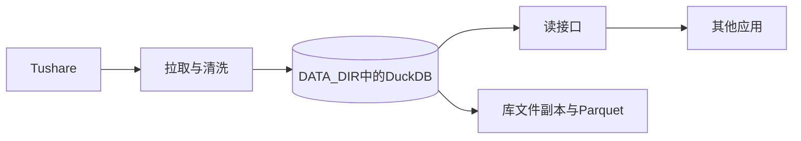

# Sprint13 迭代文档

> 版本：v0.3.13
> 状态：**进行中**
> 关联：[架构文档](../../v0.1/trading-zone-electron架构文档.md)、[接口文档](./接口文档.md)

本迭代交付一个独立的行情数据服务，给其他应用和批处理场景提供行情。桌面应用继续用本机 Python worker、`market.duckdb` 和 `trading-zone.db`，本迭代不改这条链路。

当前 Windows 开发机没有 Docker。本迭代先在本机用 FastAPI 和 DuckDB 跑通拉取、清洗、保存和读取。库文件放在环境变量 `DATA_DIR` 指向的目录，开发时就是服务目录下的 `data/`。镜像、Compose 和命名卷留到这条路径稳定之后，挂载时仍然使用同一个 `DATA_DIR`，不改表和接口。

本迭代的完整代码放在仓库根目录的 `data_service/`。该目录已经建好。桌面应用的 `src/` 和 `python/worker` 不放服务代码，服务运行时也不引用它们。

服务自己向 Tushare 拉取，按与当前应用相同的规则清洗并写入自己的 DuckDB，再通过 HTTP 把数据读出去。与桌面库的抽样对照只用于验收口径，不在两条库之间做同步。

---

## 1. 当前迭代目标

在本机先跑通行情服务：FastAPI 提供读取，DuckDB 文件负责保存。其他应用能按代码和日期读到与当前应用同口径的行情。远程镜像和卷不在本迭代。

### 1.1 目标声明

| # | 目标 | 验收口径 |
|---|---|---|
| G1 | 本机进程可启动，重启后库文件还在 | 在 `data_service` 用 uvicorn 启动后 `/health` 返回正常；`DATA_DIR` 下已有 `market.duckdb`；停掉进程再启动，表和行还在。Electron 的启动、同步和查询不经过这个服务 |
| G2 | 自有库里的行情与当前应用同口径 | 交易日历、股票主表、日线、复权因子、涨跌停、指数日线、指数权重、申万行业、股指期货、融资融券都在服务自己的库里。空值、主键覆盖、停牌缺行、退市历史、前复权与后复权的算法与 `python/worker` 现有实现一致 |
| G3 | 其他应用能读这些数据 | 持有读密钥时，可以查询覆盖范围、日历、股票、单标的 K 线。K 线支持 `none` / `qfq` / `hfq`。小结果为 JSON，日线窗口可取 Arrow |
| G4 | 服务能自己续上，并留下可恢复的副本 | 上海时间 17:00 之后按水位做增量。备份任务先 `CHECKPOINT`，再复制库文件，并导出 Parquet。复制发生在写入过程中的文件不算备份 |

### 1.2 范围边界（本迭代不做）

- 不改 `src/` 的 IPC、页面和 SQLite 业务表
- 不改 `python/worker` 的现有 handler，桌面继续本机拉取和本机查询
- 不让桌面改读远程接口，也不把服务的库挂进桌面的 `userData`
- 不在服务里保存模拟记录、交易手记、画线、自选分组、指标脚本和策略脚本
- 不做指标计算和策略沙箱
- 不开放多个写入进程。接口进程与定时任务在同一个进程里，共用一把写锁
- 不把 DuckDB 文件直接暴露到公网。对外只发布 HTTP
- 不做 Docker 镜像、Compose 和命名卷。本迭代在 Windows 本机用 Python 进程和本地目录验证

### 1.3 技术选型（本迭代）

| 层 | 选型 |
|---|---|
| 壳 / 构建 | 独立目录 `data_service/`，本机 venv 加 uvicorn。Electron 打包不包含这个目录。镜像和卷不在本迭代 |
| UI | 无界面。管理动作走带管理密钥的 HTTP |
| 业务 | FastAPI 提供读接口和管理接口。定时任务在同一进程内，于收盘后调用同一套拉取函数 |
| 数据 / 计算 | 服务自有的 DuckDB 文件 `$DATA_DIR/market.duckdb`。开发默认 `data_service/data/`。语义从现有 worker 移植进这个目录，运行时不 `import` `python/worker`，避免桌面改动把服务绑住 |
| 协议 | HTTP JSON 用于日历、股票、覆盖和管理任务。日线窗口使用 Arrow IPC，批处理使用 `DATA_DIR` 下的 Parquet。读密钥与管理密钥分开，Tushare token 只出现在服务的环境变量里 |

---

## 2. 功能需求

### 2.1 用户故事

1. 作为其他应用的调用方，我用读密钥按股票代码和日期区间取到日线，并能指定不复权、前复权或后复权。
2. 作为其他应用的调用方，我能查到股票名称、上市状态、交易日历、指数、申万行业、期货和两融，而不用连接桌面应用的数据库。
3. 作为服务的维护者，我在没有 Docker 的 Windows 开发机上用 uvicorn 启动服务，收盘后它自己补增量，重启进程后数据仍在 `DATA_DIR`。
4. 作为服务的维护者，我能拿到一份已经 `CHECKPOINT` 的库文件副本，以及一份按表导出的 Parquet，供备份和离线计算。
5. 作为桌面应用的使用者，我的同步按钮、本地行情和业务数据保持现在的行为。

### 2.2 功能清单

| ID | 功能 | 优先级 | 状态 |
|---|---|---|---|
| F01 | 本机进程、本地 DuckDB 文件、健康检查 | P0 | 已完成 |
| F02 | 服务自有库表：行情事实、股票主表、申万行业、水位 | P0 | 已完成 |
| F03 | 交易日历、股票主表、默认区间日线与复权因子的拉取和清洗 | P0 | 代码已完成，实拉待补跑 |
| F04 | 只读接口：覆盖、日历、股票、单标的 K 线 | P0 | 已完成 |
| F05 | 补齐指数、权重、申万、期货、两融、涨跌停、退市和日线历史分段 | P0 | 代码已完成，实拉待补跑 |
| F06 | 收盘后定时增量，管理接口可查看进度并手工续跑 | P0 | 代码已完成，收盘实拉待补跑 |
| F07 | `CHECKPOINT` 后的库文件备份，以及 Parquet 导出 | P0 | 已完成 |
| F08 | 与桌面库的抽样对账，只读不写回 | P1 | 脚本已完成，抽样比较待补跑 |

F01 到 F04 构成第一条可用路径：其他应用已经能读取默认区间的日线。F05 到 F07 在这条路径之上补齐全量、续跑和备份，不改已经发布的读接口路径。

### 2.3 非功能需求

- 收盘判断固定使用 `Asia/Shanghai`，不读取操作系统时区。17:00 之前不把当天算成已收盘交易日，与 `MARKET_CLOSE_HOUR` 一致。这样 Windows 开发机和以后的容器用同一条规则
- Uvicorn 单 worker。写入任务进行时，查询等待写锁，避免两个进程打开同一个可写库文件
- 日线接口必须带代码与日期窗口。不提供无过滤的全表 JSON
- 读密钥不能触发拉取、清库和备份。管理密钥不出现在读接口响应里
- Tushare 调用沿用现有间隔控制，凭据只来自环境变量 `TUSHARE_TOKEN`
- 库文件使用显式 `schema_version`。后续加列走迁移，不靠手工改文件

---

## 3. 详细设计说明

### 3.1 进程与数据流

桌面应用保持现有路径：Renderer → 主进程 → 本机 Python worker → 本机 `market.duckdb` / `trading-zone.db`。下面只画新服务。



拉取、查询和备份都只接触 `DATA_DIR` 里的库。验收时可以另取桌面库里的同一窗口做比对，比对结果不写回任何一边。

### 3.2 目录 / 模块（本迭代涉及）

本迭代的代码全部放在仓库根目录的 `data_service/`，下面这些文件已经写入。

```
data_service/
  requirements.txt
  .env.example
  reconcile.py         # 只读抽样对账；未设置桌面库路径时跳过
  tests/test_service.py
  app/
    main.py            # FastAPI：健康检查、读接口、管理接口
    config.py          # 环境变量：DATA_DIR、token、两把密钥、调度开关
    db.py              # 建表、水位、upsert、复权查询、备份
    clock.py           # Asia/Shanghai 与 17:00 收盘界
    jobs.py            # 收盘后增量、任务互斥
    job_record.py
    ingest/
      pipeline.py      # 步骤顺序与增量窗口
      steps.py
      codes.py         # 指数与期货代码，抄自看板常量
      calendar.py
      stocks.py
      daily.py         # 按交易日拉日线、复权因子、涨跌停
      reference.py     # 指数、权重、申万、期货、两融
      rate_limit.py
```

语义来源是现有代码，移植时按文件对照，不在运行时引用它们：

- 表和复权 SQL：`python/worker/db/market_db.py`
- 步骤顺序与窗口：`python/worker/pipeline_steps.py`
- 按日拉取：`python/worker/handlers/market_day.py`
- 日历、指数、期货、两融：`python/worker/handlers/pipeline_run.py`
- 股票主表字段：`python/worker/handlers/stock_list.py` 与 `src/main/db/sqlite.ts` 的 `stocks`
- 申万表字段：`src/main/db/sqlite.ts` 的 `sw_industry`、`sw_industry_member`

股票主表和申万行业在桌面里写在 SQLite。服务把这两类参照数据放进自己的 DuckDB，这样其他应用不必连接桌面业务库。

### 3.3 数据模型 / 存储

库文件：`$DATA_DIR/market.duckdb`。备份目录：`$DATA_DIR/backups/`。Parquet：`$DATA_DIR/export/`。本机不设 `DATA_DIR` 时，默认 `data_service/data/`。以后上卷时，把 `DATA_DIR` 指到挂载点即可，路径不写死成 `/data`。

| 表 | 粒度 | 说明 |
|---|---|---|
| `daily_bar` | `ts_code + trade_date` | 原始价量。停牌不补行 |
| `adj_factor` | `ts_code + trade_date` | 只存因子。复权在查询时计算 |
| `sync_trade_date` | `trade_date` | `complete` 或 `partial`，以及日线、复权行数 |
| `trade_cal` | `trade_date` | 上交所开市日 |
| `stocks` | `ts_code` | 含 `list_status`、`delist_date`。在市与退市都保留 |
| `index_daily` | `ts_code + trade_date` | 看盘用到的指数 |
| `index_weight` | `index_code + trade_date + con_code` | 成分与权重 |
| `sw_industry` / `sw_industry_member` | 行业代码 / `ts_code` | 申万行业树和成分 |
| `fut_daily` | `ts_code + trade_date` | 股指期货收盘 |
| `margin` | `trade_date + exchange_id` | 融资融券余额 |
| `stock_limit_status` | `ts_code + trade_date` | 涨跌停 |
| `sync_step_state` | `step_id` | 各步骤水位 |
| `schema_version` | 单行 | 迁移版本 |

清洗规则与现有实现保持一致：

- 数值空值写成 `NULL`，主键冲突时覆盖
- 某个交易日日线或复权因子为空，该日记为 `partial`，下次仍会重拉
- 涨跌停失败记在当日错误里，不单独把该日从 `complete` 改成 `partial`
- 增量从已有最后一天重拉，用来盖住盘后修订
- 默认日线从 `20240101` 到最近一个已收盘交易日；更早历史按三年一段回补到 `20000101`
- `qfq` 用该标的因子除以窗口右端可见的最新因子，`hfq` 除以库内最早因子，`none` 返回原始 `change` 与 `pct_chg`。复权时重算涨跌额和涨跌幅，成交量与成交额不缩放

### 3.4 协议 / API / IPC

本迭代不新增 Electron IPC。

读接口使用读密钥。日期格式与库内一致，为 `YYYYMMDD`。

| 方法 | 路径 | 返回 |
|---|---|---|
| GET | `/health` | 进程与库文件是否可打开。不要求密钥 |
| GET | `/v1/coverage` | 各表最小、最大交易日和行数 |
| GET | `/v1/calendar?start&end` | 开市日 |
| GET | `/v1/stocks?list_status=` | 股票主表 |
| GET | `/v1/bars?ts_code&start&end&adjust&format` | `format=json` 或 `format=arrow`。`adjust` 为 `none`、`qfq`、`hfq` |
| GET | `/v1/indexes/{ts_code}/bars` | 指数日线 |
| GET | `/v1/index-weights?index_code` | 最近一次成分权重 |
| GET | `/v1/industries` | 申万行业 |
| GET | `/v1/industries/{code}/members` | 行业成分 |
| GET | `/v1/margin?start&end` | 两融 |
| GET | `/v1/futures/{ts_code}/bars` | 期货收盘 |
| GET | `/v1/limits?trade_date` | 当日涨跌停 |

管理接口使用管理密钥：

| 方法 | 路径 | 行为 |
|---|---|---|
| POST | `/v1/admin/pipeline` | 从当前水位续跑。可指定单个 `step_id` |
| GET | `/v1/admin/jobs/{id}` | 当前步骤、已完成交易日、错误 |
| POST | `/v1/admin/backup` | `CHECKPOINT`，复制库文件，导出 Parquet |

批量场景直接读 `$DATA_DIR/export/` 下的 Parquet，不经 JSON。

### 3.5 核心编排

1. 启动时打开 `DATA_DIR` 下的库，执行建表和迁移，然后接受查询。
2. 手工或定时触发后，按这个顺序跑：交易日历 → 指数日线 → 股票主表 → 默认区间日线 → 历史日线分段 → 退市股票 → 指数权重 → 申万行业 → 股指期货 → 融资融券。日线的每个交易日同时写入复权因子和涨跌停。
3. 已标记 `complete` 的交易日跳过。失败日期保持 `partial`，下一轮继续。
4. 查询只读已提交的数据。复权在 SQL 中临时计算，不另存一张复权表。
5. 备份在没有拉取任务时运行。先 `CHECKPOINT`，再把库文件复制到 `$DATA_DIR/backups/`，然后按表写出 Parquet。

### 3.6 UI（若有）

无界面。

### 3.7 契约（若有）

| 层级 | 位置 |
|---|---|
| HTTP | `data_service/app/main.py` 中的路径，本迭代新增 |
| Python 模型 | `data_service/app/`，本迭代新增 |
| 参照实现 | `python/worker/db/market_db.py`、`python/worker/pipeline_steps.py`。只作口径来源，不改这些文件 |

---

## 4. 任务步骤

顺序是依赖顺序。先在本机把 FastAPI 和 DuckDB 跑通，再补全量和备份。镜像和卷不插入这些步骤。

| 步骤 | 任务 | 产出 | 状态 |
|---|---|---|---|
| 1 | 在已有的根目录 `data_service` 中建立本机 venv 和 uvicorn 入口。`DATA_DIR` 默认指向 `data/`，进程单 worker | 空库可创建，`/health` 可用，重启进程后文件还在 | 已完成 |
| 2 | 按第 3.3 节建表，写入 `schema_version`，实现 upsert 与复权查询 | 服务自有库结构 | 已完成 |
| 3 | 移植交易日历、股票主表、默认区间日线、复权因子和水位。先用一个短窗口跑通 | `DATA_DIR` 里有可查询的日线 | 代码已完成。未配置 token，Tushare 短窗口与全量回填待补跑 |
| 4 | 实现 F04 的只读接口和读密钥 | 其他应用能按代码和日期取 K 线 | 已完成 |
| 5 | 按第 3.5 节的剩余步骤补齐全量和历史分段 | 数据集与 G2 一致 | 代码已完成。实拉数据待补跑 |
| 6 | 加上收盘后定时任务和管理接口的进度查询 | 服务在桌面未打开时仍能增量 | 代码已完成。收盘后的真实增量待补跑 |
| 7 | 实现备份与 Parquet 导出 | `$DATA_DIR/backups/` 与 `$DATA_DIR/export/` | 已完成 |
| 8 | 抽样对照桌面库的同一代码和窗口 | 对账记录。不写回桌面库 | 脚本已完成。未设置桌面库路径，抽样比较待补跑 |

第 4 步完成时，其他应用已经能读取默认区间日线。第 5 步到第 7 步补的是数据集、续跑和副本，读接口的路径保持不变。

### 4.1 本地复现命令

在 PowerShell 中，工作目录为 `data_service`。本机 PyPI 官方源会超时，安装依赖时使用清华镜像。只做健康检查时把调度关掉，避免 17:00 之后在没有短窗口限制的情况下启动全量拉取。

```powershell
cd data_service
py -3 -m venv .venv
.\.venv\Scripts\Activate.ps1
pip install -r requirements.txt -i https://pypi.tuna.tsinghua.edu.cn/simple --timeout 120
$env:DATA_DIR = "data"
$env:SCHEDULER_ENABLED = "0"
.\.venv\Scripts\python.exe -m app --tushare-token "你的token"
```

默认监听 `0.0.0.0:18080`，同一台机器用 `127.0.0.1`，局域网里的其他电脑用这台机器的 IP。要换端口时加上 `--port`。另开一个终端：

```powershell
curl.exe -s http://127.0.0.1:18080/health
```

单测与跳过对账：

```powershell
cd data_service
.\.venv\Scripts\python.exe -m pytest -q
.\.venv\Scripts\python.exe reconcile.py
```

配置 `TUSHARE_TOKEN` 后，用管理密钥调用 `POST /v1/admin/pipeline`，请求体可带 `max_days`。全量回填不要带 `max_days`。备份用 `POST /v1/admin/backup`。桌面应用的启动和同步命令保持不变。

---

## 5. 测试结果 / 总结反馈

### 5.1 验收清单与结果

| 检查项 | 方式 | 结果 | 说明 |
|---|---|---|---|
| G1 本机启动与重启保留 | 手工：uvicorn 启动，停进程后再启动 | 通过 | 两次 `GET /health` 都是 `{"status":"ok"}`。停进程后只读打开同一库，`schema_version` 为 1。本迭代不使用 Docker |
| G2 拉取与清洗口径 | 单测写入水位与复权；全量完成后查各表覆盖 | 部分通过 | 空日线记 `partial`，涨跌停失败不把 `complete` 改成 `partial`，复权价与成交量口径有单测。未配置 `TUSHARE_TOKEN`，短窗口实拉和全量回填待补跑 |
| G3 外部读取 | 读密钥请求日历、股票和一只股票的三种复权 | 部分通过 | 单测覆盖 none、qfq、hfq、Arrow 和日期校验。没有对真实拉取结果发请求 |
| G4 定时与备份 | 单测调度条件与备份只读连接 | 部分通过 | 上海时间 17:00 前后的调度判定、进行中任务 409、备份副本与 Parquet 有单测。常驻进程上的收盘增量待补跑 |
| F08 抽样对账 | 不设置 `DESKTOP_DUCKDB_PATH` 运行 `reconcile.py` | 跳过 | 脚本打印跳过并退出 0。同一代码和窗口的比较待补跑，不写回桌面库 |
| 桌面数据链路未改 | 查看工作区变更 | 通过 | 变更只有 `.gitignore`、`data_service/`、`docs/releases/v0.3/Sprint13/`。没有 `src/` 与 `python/worker` |

### 5.2 关键命令记录

2026-11-02，工作目录 `data_service`。依赖已装在 `.venv`（含 duckdb 2.0.0、tushare 1.4.29）。健康检查时 `SCHEDULER_ENABLED=0`，避免收盘后自动开拉。

单测：

```text
.\.venv\Scripts\python.exe -m pytest -q
.............                                                            [100%]
13 passed, 5 warnings in 2.59s
```

警告来自 Starlette 对 httpx TestClient 的弃用提示，以及 DuckDB 提示 `to_arrow_table()` 会多复制一次结果。测试没有失败。

健康检查与重启。第一次启动后：

```text
curl.exe -s http://127.0.0.1:8080/health
{"status":"ok"}
DB_EXISTS
```

停进程，再用同一 `DATA_DIR=data` 启动，`/health` 仍为 `{"status":"ok"}`。服务运行时，另一个进程无法打开同一个 `market.duckdb`（Windows 文件占用）。停掉 uvicorn 后只读查询：

```text
[(1,)]
```

即 `schema_version` 仍为 1。

对账脚本未设置桌面库路径：

```text
.\.venv\Scripts\python.exe reconcile.py
抽样对账

  状态: 跳过
  原因: 未设置 DESKTOP_DUCKDB_PATH
```

退出码 0。全量回填没有执行。

### 5.3 总结反馈

**做得好的地方**

- 服务和桌面的数据路径分开之后，落地顺序可以按调用方来排：先有持久化和一份可读日线，再花时间做全量回填
- 开发机没有 Docker，所以本迭代先验证进程、库文件和接口。数据目录收成 `DATA_DIR`，以后挂卷只改这个变量
- 股票主表和申万行业放进服务自己的库，其他应用不需要桌面的 SQLite
- 复权、空日线、涨跌停失败、调度时刻和备份副本都落在单测里，不依赖 Tushare 额度

**暴露的问题 / 摩擦**

- 口径目前写在桌面 worker 里。服务复制了一份实现，以后两边的清洗规则可能各改各的。抽样对账脚本已经能在未配置路径时跳过，真正的数值比较还要等桌面库路径
- 全量日线回填耗时长，而且受 Tushare 额度限制。本次没有配置 token，短窗口实拉和全量回填都还没跑
- DuckDB 2.0 的连接没有 `fetch_arrow_table`，读接口改为执行语句后调用 `to_arrow_table()`
- Windows 上库文件被写入进程占用时，另一个连接打不开。备份因此先 `CHECKPOINT`，再关掉连接、复制、重新打开
- `tushare` 1.4.29 不会自己带上 `six`，`requirements.txt` 里需要显式写出这个依赖
- 本机访问 `files.pythonhosted.org` 超时，依赖是用清华镜像装上的

---

## 6. 改进目标

### 6.1 短期（下一迭代可做）

1. 在本机路径跑通之后补 `Dockerfile` 和 Compose。命名卷挂到 `DATA_DIR`，表结构、清洗规则和 HTTP 路径保持不变
2. 若第 4 步的调用方还需要批量多标的窗口，增加批量 Arrow 接口，沿用单标的的复权参数
3. 在反向代理上加 TLS，仍然只发布 HTTP，不发布库文件所在目录

### 6.2 中期

1. Parquet 按表和年份分区，供研究脚本直接扫描，不必把整库下载走
2. 给 `schema_version` 补第一次真正的加列迁移，确认已有的 `DATA_DIR` 可以升级
3. 设置 `DESKTOP_DUCKDB_PATH` 后跑 `data_service/reconcile.py`，比较同一代码和窗口的原始收盘价与复权因子。脚本已经能在未设置路径时跳过

### 6.3 长期

1. 服务需要单独发版时，把 `data_service/` 拆成独立仓库。拆分前保持它不依赖 Electron 运行时
2. 读取压力上去之后，用 Parquet 或库文件副本做只读查询，继续保持一个写入进程

---

## 附录

### A. 相关文档

- [架构文档](../../v0.1/trading-zone-electron架构文档.md)：桌面应用现有的数据面。本迭代不修改该路径
- 口径参照：`python/worker/db/market_db.py`、`python/worker/pipeline_steps.py`、`python/worker/handlers/market_day.py`

### B. 常用命令

| 命令 | 用途 |
|---|---|
| `.\.venv\Scripts\python.exe -m app --tushare-token "你的token"` | 在 `data_service` 中启动服务，默认端口 `18080`。只做健康检查时设 `SCHEDULER_ENABLED=0` |
| `curl.exe -s http://127.0.0.1:18080/health` | 检查进程。2026-11-02 曾在 `8080` 上两次返回 `{"status":"ok"}` |
| `.\.venv\Scripts\python.exe -m pytest -q` | 单测。2026-11-02 为 13 passed |
| `.\.venv\Scripts\python.exe reconcile.py` | 未设置桌面库路径时跳过，退出码 0 |
| 桌面原有启动与同步命令 | 继续验证桌面自己的数据链路，本迭代不替换它们 |
