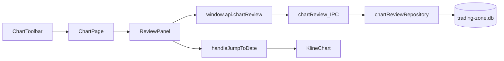

# Sprint15 迭代文档

> 版本：v0.3.15
> 状态：**进行中**
> 关联：[需求文档](./需求文档.md)、[架构文档](../../v0.1/trading-zone-electron架构文档.md)

本迭代在图表页加上人工复盘。使用者每天拉完行情后，用左侧已有的标的范围挑出一组标的，打开右侧复盘面板，对照当前 K 线勾选预设的系统条件，并按标的和日期保存。

条件全部由人判断。本迭代不读取指标、策略或 Python worker 来自动打勾。

---

## 1. 当前迭代目标

在图表页交付可用的人工复盘：工具栏能打开右侧面板，面板能按日期填写看多与看空条件，保存后换标的、换日期、重启应用仍能读回同一条记录。

### 1.1 目标声明

| # | 目标 | 验收口径 |
|---|---|---|
| G1 | 只有图表页出现复盘入口 | 侧栏进入「图表」后，工具栏有「复盘」按钮。选股页、模拟盘页的图表工具栏没有该按钮，右侧仍是各自的常驻面板 |
| G2 | 右侧面板能对照当前图填写并保存 | 选中标的后点击「复盘」，右侧出现日历和条件表单。选中日历中的交易日，主图跳到该日附近。填写后点保存，再次进入同一标的、同一日期，表单与上次一致 |
| G3 | 一条记录对应一支标的的一个日期 | 换标的或换日期会加载另一条记录。保存覆盖该标的该日的旧内容。清空删除该条记录，该日回到空白表单 |
| G4 | 条件表单与需求中的字段一致 | 看多、看空两组字段、条件备注和「清空 / 保存」都在面板里。修改不单独做按钮，再次保存即覆盖 |

### 1.2 范围边界（本迭代不做）

- 不在选股、模拟盘、仪表盘、行情、手记页面加入复盘按钮或复盘面板
- 不根据均线、成交量、波动率或策略脚本自动勾选条件
- 不新增标的组选择器。复盘沿用图表页左侧已有的范围（全市场、指数成分、行业、自选分组）
- 不做某一日、某一组的完成度汇总，不做导出
- 不在 K 线上标记已复盘日期。已保存日期只在面板日历上标出
- 不把手记、画线、模拟盘记录和复盘记录互相引用
- 不改行情拉取、`market.duckdb` 和 Python worker
- 不提供周线、月线复盘。表单日期只对应当前标的日线里存在的交易日
- 不让使用者增删条件项。条件集合在本迭代写死

### 1.3 技术选型（本迭代）

| 层 | 选型 |
|---|---|
| 壳 / 构建 | 现有 Electron。不新增 npm 依赖，日历用现有 MUI 画月历，日期输入风格与工具栏跳转一致 |
| UI | 图表页 `ChartPage` 增加复盘开关。面板放在现有右侧栏，与策略面板共用这一列 |
| 业务 | 渲染进程收集表单。主进程用共享校验函数重校验后写入 SQLite。不经过 Python |
| 数据 / 计算 | `userData/data/trading-zone.db` 新表 `chart_review`。一行的主键是 `ts_code + trade_date`。表单正文放校验后的 JSON |
| 协议 | 新增 IPC：`chartReview:get`、`chartReview:dates`、`chartReview:save`、`chartReview:clear`。日期使用图表已有的 `YYYY-MM-DD` |

---

## 2. 功能需求

### 2.1 用户故事

1. 作为复盘的人，我在图表页打开复盘面板，左侧仍用现有范围切换标的组，逐个标的对照 K 线勾选系统条件。
2. 作为复盘的人，我在面板日历上选择交易日，主图跳到该日，表单显示这一天已保存的内容；这一天没有记录时，表单是空白的。
3. 作为复盘的人，我可以只填写看多、只填写看空，或两组都填。保存后换到别的标的再回来，内容还在。
4. 作为复盘的人，我发现某天判断有误时直接改表单再保存；我想放弃这一天的记录时点清空。
5. 作为同时使用选股和模拟盘的人，那两个页面的图表保持现在的工具栏和右侧面板。

### 2.2 功能清单

| ID | 功能 | 优先级 | 状态 |
|---|---|---|---|
| F01 | 图表页工具栏「复盘」按钮，打开或关闭右侧面板 | P0 | 已完成 |
| F02 | 复盘月历：只可选当前标的日线中的交易日，已保存日期有标记 | P0 | 已完成 |
| F03 | 看多条件：关键点、矩形、波动率、成交量放大、站上均线、2B、板块领头羊 | P0 | 已完成 |
| F04 | 看空条件：跌破底分型、破位下跌、高位放天量、技术压力位 | P0 | 已完成 |
| F05 | 条件备注：矩形位置、是否回踩、放量倍数、领头羊标的、压力位说明 | P0 | 已完成 |
| F06 | 保存覆盖、清空删除，按标的和日期各一条 | P0 | 已完成 |
| F07 | 未保存就换标的、换日期或关闭面板时，提示保存或放弃 | P1 | 已完成 |

看多与看空写在同一张表单、同一条记录里。两组可以同时有值，本迭代不要求先选定方向。

### 2.3 非功能需求

- 主进程保存前再用 `src/shared` 里的同一套整理函数。非法枚举不能入库。选项和备注都可以空着
- 复盘只写 `trading-zone.db`。行情库、画线和手记表保持原样
- 切换标的时按当前复盘日期重新读取。读取失败时面板给出错误，并保留用户还没保存的草稿
- 回放进行中不打开复盘。回放会截断可见 K 线，和「对照完整日线打勾」不是同一件事
- 面板内容超出高度时在面板内滚动，主图区域保持可看

---

## 3. 详细设计说明

### 3.1 进程与数据流



渲染进程负责日历、表单和脏状态。主进程负责校验和落库。选中日期后调用图表页已有的 `handleJumpToDate`，由 `nearestTradingDate` 把视图定位到该标的日线上的对应 K 线。

打开复盘时，右侧栏显示复盘面板，暂时让出策略面板，并清掉策略叠加。关闭复盘后，若打开前选中过策略，恢复该策略面板和叠加。选股页、模拟盘页通过 `rightPanel` 占用右侧栏，图表页不向它们传入复盘开关。

### 3.2 目录 / 模块（本迭代涉及）

```
src/shared/types/chartReview.ts          # 表单类型与枚举
src/shared/chartReview/readChartReview.ts # 校验与空白判断
src/main/db/sqlite.ts                    # 增加 chart_review 建表
src/main/db/chartReviewRepository.ts
src/main/ipc/registerHandlers.ts         # 四个 chartReview 通道
src/preload/index.ts
src/preload/index.d.ts
src/renderer/src/pages/chart/ChartToolbar.tsx
src/renderer/src/pages/chart/ReviewPanel.tsx
src/renderer/src/pages/ChartPage.tsx
```

图表页入口仍是 `src/renderer/src/App.tsx` 在 `page === 'chart'` 时渲染的无参 `ChartPage`。选股是 `ScreenerPage`，模拟盘是 `PaperTradingPage`，二者已经传入 `showToolbarExtras={false}` 和自己的 `rightPanel`。复盘按钮只在 `showToolbarExtras` 为真且没有外部 `rightPanel` 时交给 `ChartToolbar`。

### 3.3 数据模型 / 存储

表建在 `initDb` 已执行的 `MIGRATION_SQL` 中，与 `chart_drawing`、`trade_journal` 一样用 `CREATE TABLE IF NOT EXISTS`。

| 列 | 说明 |
|---|---|
| `ts_code` | 当前图表标的，含指数代码。与 `trade_date` 组成主键 |
| `trade_date` | `YYYY-MM-DD`，必须是该标的日线中的一根 |
| `payload` | 校验通过的表单 JSON |
| `updated_at` | ISO 时间，每次保存更新 |

索引：`chart_review(ts_code, trade_date)`。按标的列出已保存日期时走这个主键。

`payload` 字段：

| 字段 | 取值 | 备注 |
|---|---|---|
| `keyPoint` | `left` / `none` / `right` / `null` | 可空 |
| `rectangle` | `absent` / `inside` / `breakout` / `null` | 可空。`inside` 时可填 `rectanglePosition`，`breakout` 时可填 `rectangleRetest` |
| `rectanglePosition` | 字符串或 `null` | 矩形中的位置，可空 |
| `rectangleRetest` | `yes` / `no` / `null` | 突破后是否回踩，可空 |
| `volatility` | `squeeze` / `expand` / `null` | 可空 |
| `volumeExpand` | `yes` / `no` / `null` | 可空。`yes` 时可填 `volumeMultiple` |
| `volumeMultiple` | 数或 `null` | 放量倍数，可空，保留用户输入的小数 |
| `aboveMa` | `5`、`20`、`60`、`120`、`250` 的数组 | 可多选，空数组表示未选 |
| `rule2b` | `yes` / `no` / `null` | 可空 |
| `sectorLeader` | `yes` / `no` / `null` | 可空。`yes` 时可填领头羊标的 |
| `breakBottomFractal` | `yes` / `no` / `null` | 可空 |
| `breakdown` | `yes` / `no` / `null` | 可空 |
| `climaxVolume` | `yes` / `no` / `null` | 可空 |
| `resistance` | `yes` / `no` / `null` | 可空。`yes` 时可填 `resistanceNote` |
| `resistanceNote` | 字符串或 `null` | 技术压力位说明，可空 |

选项和备注都可以不填。未选存 `null`，不写成否。与当前选项无关的备注清空后再入库，避免切回「否」后仍留下旧倍数或旧说明。

### 3.4 协议 / API / IPC

渲染进程经 `window.api.chartReview` 调用。通道与画线、手记一样由 `registerHandlers.ts` 注册。

| 通道 | 参数 | 返回 |
|---|---|---|
| `chartReview:get` | `{ tsCode, tradeDate }` | 记录或 `null` |
| `chartReview:dates` | `{ tsCode }` | 该标的已保存的 `tradeDate` 列表 |
| `chartReview:save` | `{ tsCode, tradeDate, draft }` | 保存后的记录 |
| `chartReview:clear` | `{ tsCode, tradeDate }` | 无。该主键不存在时也视为成功 |

`tradeDate` 不符合 `YYYY-MM-DD`、标的为空、或 `draft` 通不过 `readChartReview` 时，主进程抛出错误，面板显示错误文案，草稿留在表单里。

### 3.5 核心编排

1. 进入图表页并选中标的后，复盘按钮可点。未选标的、无日线、或回放进行中时按钮不可用。
2. 打开面板时，复盘日期默认取当前图最后一根 K 线的日期。读取该标的该日记录；没有记录则显示空白表单。同时读取该标的全部已保存日期，供日历打点。
3. 日历只允许选择 `chartTimes` 里的日期。选中后更新复盘日期、重新读取记录，并调用 `handleJumpToDate`。
4. 更换标的时，若新标的的日线含有当前复盘日期，保持该日期；否则改到新标的最后一根 K 线。两种情况都重新读取。
5. 保存走 `chartReview:save`。该主键已有记录时覆盖 `payload` 和 `updated_at`。界面始终是一个「保存」按钮。
6. 清空先确认，再走 `chartReview:clear`，表单回到空白，日历去掉该日标记。
7. 表单与已加载记录不一致时记为脏。换日期、换标的或关闭面板时询问保存或放弃。保存失败则留在当前标的和日期。

### 3.6 UI

面板自上而下：

- 标题「复盘」、当前标的、关闭
- 月历。非交易日不可选。已有记录的交易日显示标记。当月没有可选交易日时，月份仍可翻，表单不可编辑
- 看多分组：关键点三选一；矩形三选一，选中「矩形中」后出现位置输入，选中「突破矩形」后出现是否回踩；波动率二选一；成交量放大二选一，选中「是」后出现倍数；站上均线五项可多选；2B 二选一；板块领头羊二选一，选中「有」后从本地股票中指定标的
- 看空分组：跌破底分型、破位下跌、高位放天量、技术压力位，均为是或否。技术压力位选「是」后出现说明
- 底部「清空」「保存」。无记录时清空不可用。表单未改时保存不可用

状态：

| 状态 | 表现 |
|---|---|
| 未选标的 | 按钮不可用。面板若已开，显示「请从左侧选择股票」 |
| 读取中 | 日历和表单不可编辑，显示「加载中…」 |
| 无记录 | 空白表单，日历该日无标记 |
| 读取失败 | 显示错误，保留草稿，保存仍可重试 |
| 校验失败 | 字段旁说明缺什么，不发保存 |
| 保存成功 | 脏状态清除，该日加上标记 |

宽度沿用右侧栏拖动条，单独记住在 `trading-zone.chart.reviewWidth`，避免和策略面板宽度互相覆盖。

### 3.7 契约

| 层级 | 位置 |
|---|---|
| TypeScript | `src/shared/types/chartReview.ts`、`src/shared/chartReview/readChartReview.ts` |
| IPC | `src/preload/index.ts` 与 `src/main/ipc/registerHandlers.ts` |
| SQLite | `src/main/db/sqlite.ts`、`src/main/db/chartReviewRepository.ts` |

本迭代没有 JSON Schema，也没有 Python 模型。

---

## 4. 任务步骤

| 步骤 | 任务 | 产出 | 状态 |
|---|---|---|---|
| 1 | 写下表单类型和 `readChartReview`：枚举、条件备注、空白拒绝、无关备注清除 | 渲染进程和主进程共用的校验 | 已完成 |
| 2 | 在 `trading-zone.db` 建 `chart_review`，实现按主键读取、列出日期、覆盖保存、删除 | `chartReviewRepository` | 已完成 |
| 3 | 注册四个 IPC，并挂到 `window.api.chartReview` | preload 与 handler | 已完成 |
| 4 | 做 `ReviewPanel`：月历、两组表单、备注、清空和保存 | 面板组件 | 已完成 |
| 5 | 图表页接入按钮和右侧栏。打开时让出策略面板，关闭时恢复。脏记录未处理时拦截切换 | `ChartToolbar`、`ChartPage` | 已完成 |
| 6 | 按第 5 节清单在图表、选股、模拟盘三条路径手工验收 | 验收记录回写第 5 节 | 待验收 |

### 4.1 本地复现命令

```powershell
npm run typecheck
npm run dev
```

开发窗口打开后进入「图表」。准备至少两支有日线的标的，以及一个已有成员的自选分组，用来确认左侧范围可以照常切换。

---

## 5. 测试结果 / 总结反馈

代码已接入图表页。类型检查和临时库上的读写脚本已经跑过。开发窗口里的点击路径还没有走，对应行保持待验收。

### 5.1 验收清单与结果

| 检查项 | 方式 | 结果 | 说明 |
|---|---|---|---|
| G1 图表页有复盘，选股和模拟盘没有 | 手工 | 待验收 | 三页各看一次工具栏和右侧栏 |
| G2 选日期后主图定位，保存后重进仍在 | 手工 | 待验收 | 保存后重启 `npm run dev` 再打开同一标的同一日 |
| G3 不同标的、不同日期互不覆盖；清空后该日为空 | 手工 | 待验收 | 两支标的各写一天，再清空其中一条 |
| G4 字段与备注齐全；再次保存覆盖旧值 | 手工 | 待验收 | 矩形位置、回踩、倍量、领头羊、压力位说明留空也可以保存 |
| F07 脏表单切换前提示 | 手工 | 待验收 | 修改后换日期、换标的、关闭面板各一次 |
| 回放中按钮不可用 | 手工 | 待验收 | 开始回放后看工具栏 |
| 全部未选可以保存 | 脚本 | 通过 | 空白草稿能通过 `readChartReview`。界面上没有改动时保存按钮仍不可用 |
| `npm run typecheck` | 脚本 | 通过 | 2026-11-04，主进程与渲染进程均通过 |

### 5.2 关键命令记录

2026-11-04：

```
npm run typecheck
```

`typecheck:node` 与 `typecheck:web` 均通过。

另用临时目录里的 `trading-zone.db` 跑过整理和 repository：矩形位置会去掉首尾空格；未选中的领头羊代码不会入库；同一标的同一日期再次保存会覆盖；清空不存在的行不报错；另一支标的的记录不受影响。空白表单现在可以保存。脚本在删除仍被打开的临时库文件时遇到文件占用，断言本身已经通过。

`npm run dev` 已拉起。主进程、preload 和渲染进程都构建成功，Python worker 返回 ready，Vite 优化了新增的 `FactCheck` 图标。日志里没有启动错误。图表页、选股页、模拟盘页的点击还没做。

### 5.3 总结反馈

**做得好的地方**

- 渲染进程和主进程共用 `readChartReview`。选项和备注都可以空着保存。
- 复盘按钮只在没有外部右侧栏的图表页出现，选股和模拟盘沿用原来的 `showToolbarExtras` 与 `rightPanel`。

**暴露的问题 / 摩擦**

- 图表、选股、模拟盘三条界面路径还没有在 `npm run dev` 里点过。
- 表单没有改动时保存按钮不可用。备注留空不再拦住保存。

---

## 6. 改进目标

### 6.1 短期（下一迭代可做）

1. 在当前标的组上按选定日期列出已复盘和未复盘的标的，并给出下一条未复盘标的。
2. 用本地日线算出均线位置和量比，显示在对应选项旁边，仍由人勾选后才入库。
3. 在主图时间轴上标出已有复盘的日期。

### 6.2 中期

1. 按标的组、日期区间汇总看多与看空选项的数量。
2. 导出某一组在一段日期内的复盘记录。
3. 从一条复盘记录打开或新建对应标的的交易手记。

### 6.3 长期

1. 条件集合可按交易系统配置，而不是写死在这一版表单里。
2. 先用规则筛出候选标的，再进入本面板做人工确认。

---

## 附录

### A. 相关文档

- [需求文档](./需求文档.md)
- [架构文档](../../v0.1/trading-zone-electron架构文档.md)

### B. 常用命令

| 命令 | 用途 |
|---|---|
| `npm run dev` | 开发起窗 |
| `npm run typecheck` | 主进程与渲染进程类型检查 |
