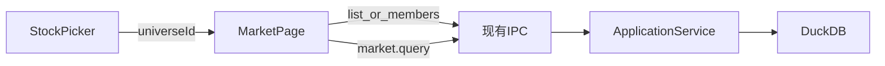

# Sprint4 迭代文档

> 版本：v0.3.4
> 状态：**进行中**
> 关联：[Sprint1 需求文档](../Sprint1/需求文档.md)、[Sprint2 需求分析](../Sprint2/需求分析.md)、[Sprint3 需求分析](../Sprint3/需求分析.md)、[改进收集](../改进收集.md)

本迭代只改三处已经在用的界面：数据页的分类浏览、深色滚动条、仪表盘统计区右侧的滚动命中带。不新增同步步骤，不改查询协议。

---

## 1. 当前迭代目标

把侧栏「行情」收成一张按分类浏览本地数据的页面，并修掉深色滚动条白底、仪表盘统计图贴住滚动条这两处观感问题。

### 1.1 目标声明

| # | 目标 | 验收口径 |
|---|---|---|
| G1 | 侧栏入口改称「数据」 | 提示与无障碍名称都是「数据」；点进去仍是现在的日线表 |
| G2 | 数据页用和图表页同一套分类看对应列表和日线 | 全市场、退市、大盘指数、宽基指数、成分股、行业都能选出列表；点一只能出日线；指数不能切复权 |
| G3 | 深色模式滚动条不再是白底 | 切到深色后，表格、列表、统计区的滚动槽跟页面底色，滑块是深灰；切回浅色后滚动条保持现在的样子 |
| G4 | 仪表盘右半边统计可以靠滚动条滚动 | 统计图与滚动条之间有一条可放光标的右边距；光标放在这条边距上滚轮时页面滚动，图内滚轮仍是缩放 |

### 1.2 范围边界（本迭代不做）

- 不新增数据表，不改配置页的同步步骤
- 不把两融、期指、成分权重做成另一套表
- 不改图表页、模拟盘的分类和滚轮
- 不跟系统外观，不为浅色模式单独画滚动条
- 不改 lightweight-charts 在图内的滚轮缩放
- 页面标识继续用 `market`，组件继续叫 `MarketPage`

### 1.3 技术选型（本迭代）

| 层 | 选型 |
|---|---|
| 壳 / 构建 | 现有 Electron，无新进程 |
| UI | MUI。分类复用 `StockPicker` 已有的范围按钮和 `UniversePickerDialog` |
| 业务 | 列表过滤对齐 `ChartPage.resolvePickerStocks` |
| 数据 / 计算 | 现有 `market.query`、`stocks.list`、`stocks.listDelisted`、`industry.members`、`market.indexConstituents`。指数日线已由 `queryOhlcv` 走到 `index_daily` |
| 协议 | 无新 IPC |

---

## 2. 功能需求

### 2.1 用户故事

1. 作为用户，我在侧栏看到「数据」，点进去按分类查看本地日线，而不是只看到全部股票。
2. 作为用户，我选大盘指数、宽基指数、某指数成分或某个行业后，左侧列表换成这一类，右侧表显示当前选中代码的日线。
3. 作为用户，我在深色模式下滚动表格和统计区时，滚动槽不再是一块白底。
4. 作为用户，我在仪表盘右侧统计区把光标放在滚动条旁边滚动页面，不会因为碰到图表而被缩放。

### 2.2 功能清单

| ID | 功能 | 优先级 | 状态 |
|---|---|---|---|
| F01 | 侧栏「行情」改为「数据」 | P0 | 已完成 |
| F02 | 数据页左侧加入分类选择器 | P0 | 已完成 |
| F03 | 分类切换后加载对应列表并查询日线 | P0 | 已完成 |
| F04 | 指数标的固定未复权，复权按钮不可用 | P0 | 已完成 |
| F05 | 深色模式滚动条槽和滑块换色 | P0 | 已完成 |
| F06 | 统计区滚动容器加右边距 | P0 | 已完成 |

### 2.3 非功能需求

- 切换分类、切换颜色模式都不刷新窗口、不重建图表页的 K 线
- 数据页记住自己的分类，键与图表页分开，两边互不覆盖
- 浅色模式的页面底色、表格、滚动条保持现状
- 指数日线里没有的盘后量、盘后额、复权因子继续显示「—」

---

## 3. 详细设计说明

### 3.1 进程与数据流

分类和滚动条都停在渲染进程。日线仍走现有查询。



主路径：

1. `MarketPage` 持有 `universeId`，缺省 `all`。
2. 用户在 `UniversePickerDialog` 里选定分类。
3. 列表来源与 `ChartPage.resolvePickerStocks` 相同：全市场用 `stocks.list`，退市用 `stocks.listDelisted`，大盘 / 宽基用 `DASHBOARD_MARKET_INDICES` / `DASHBOARD_BROAD_INDICES`，行业用 `industry.members`，成分用 `market.indexConstituents`。
4. 选中代码后仍调用 `window.api.market.query`。指数代码由现有 `queryOhlcv` 读 `index_daily`。

颜色模式已经在 `ColorModeProvider` 里。滚动条样式挂在同一处，读当前 `palette.mode`。

### 3.2 目录 / 模块（本迭代涉及）

```
src/renderer/src/layout/AppShell.tsx
src/renderer/src/pages/MarketPage.tsx
src/renderer/src/pages/ChartPage.tsx          # 抽出列表解析时才动
src/renderer/src/pages/StockPicker.tsx        # 已支持 onUniverseChange，数据页接上即可
src/renderer/src/pages/chart/UniversePickerDialog.tsx
src/renderer/src/theme/colorMode.tsx
src/renderer/src/pages/dashboard/StatsPanel.tsx
src/shared/constants/chartUniverse.ts
```

列表解析从 `ChartPage` 收到渲染进程一处共用函数，图表页和数据页都调用它。不放进主进程。

### 3.3 数据模型 / 存储

无新表。

| 键 | 位置 | 内容 |
|---|---|---|
| `trading-zone.market.universeId` | `localStorage` | 数据页当前分类，缺省 `all` |
| `trading-zone.chart.universeId` | `localStorage` | 图表页分类，本迭代不改 |
| `tz.colorMode` | `localStorage` | `light` / `dark`，本迭代不改 |

数据页沿用已有的列显隐键 `trading-zone.market.optionalColumns` 和列表宽度键 `trading-zone.market.stockPickerWidth`。

### 3.4 协议 / API / IPC

无新通道。沿用：

| 调用 | 用途 |
|---|---|
| `stocks.list` | 全市场、以及成分 / 行业过滤的母集 |
| `stocks.listDelisted` | 退市股票 |
| `industry.members` | 行业成分 |
| `market.indexConstituents` | 指数成分 |
| `market.query` | 选中代码的日线；指数走 `index_daily` |

指数查询的 `adjust` 固定传 `none`。

### 3.5 核心编排

数据页加载：

1. 读本地分类。非法或空值落回 `all`。
2. 并行取股票列表和 `market.coverage`，覆盖的 `max_date` 仍作为查询结束日。
3. 按分类解析左侧列表。当前选中代码不在新列表里时，选中第一项。
4. 有选中代码就 `market.query`。指数时复权固定 `none`，复权按钮禁用。

空列表文案对齐图表页已有口径：行业无数据时提示到配置页更新行业分类；成分快照为空时沿用图表页的空状态，不新造一套同步入口。

### 3.6 UI

**侧栏。** `AppShell` 里该按钮的提示和 `aria-label` 改为「数据」。图标用 `TableChartIcon`。

**页边距。** 数据页内容区和图表页一样贴边，`padding: 0`。左侧列表、分隔条、右侧表格直接顶到内容区边缘。

**数据页。** 左侧 `StockPicker` 传入 `onUniverseChange`，顶部出现和图表页相同的分类按钮和「选择标的范围」对话框。对话框三个页签不变：指数行情、成分股、行业。右侧表、列菜单、复权切换、分页、排序保持现状。标题在指数时仍是「名称（代码）日线」。未同步股票列表时的空页文案改为「尚未同步数据」。

**滚动条。** 只在 `palette.mode === 'dark'` 时加全局样式，挂在 `ColorModeProvider` 里，和 `CssBaseline` 一起生效。

| 部位 | 深色 |
|---|---|
| 槽 | `#121417`，与 `background.default` 相同 |
| 滑块 | `#3a3f46`，与图表坐标轴边相同 |
| 滑块悬停 | `#6b7078` |

同时写 `scrollbar-color`，让不走 WebKit 伪元素的滚动条也用这一对颜色。WebKit 一旦改槽和滑块，就要给出宽度，否则滚动条会消失。深色模式用 12px，不比系统滚动条更粗。浅色模式不加这套样式。

**仪表盘。** `StatsPanel` 滚动容器现有 `pr: 0.5`（4px），图贴着滚动条。改为 `pr: 2`（16px）。这条边距属于滚动容器，不画进 lightweight-charts。光标在边距上时事件落在容器上，滚轮滚动；光标在图上时仍由图表缩放。左半边日 K 和指数列表不加这条边距。

### 3.7 契约

无新契约。分类 id 继续用 `src/shared/constants/chartUniverse.ts` 里的 `all`、`delisted`、`index:market`、`index:broad`、`constituents:{ts_code}`、`industry:{index_code}`。

---

## 4. 任务步骤

| 步骤 | 任务 | 产出 | 状态 |
|---|---|---|---|
| 1 | 侧栏文案改为「数据」，空页文案改成数据口径 | `AppShell.tsx`、`MarketPage.tsx` | 已完成 |
| 2 | 抽出列表解析，图表页改为调用它 | `resolveUniverseStocks.ts`、`ChartPage.tsx` | 已完成 |
| 3 | 数据页接入分类、独立本地键、指数禁用复权 | `MarketPage.tsx` | 已完成 |
| 4 | 深色滚动条样式挂到颜色模式 | `colorMode.tsx` | 已完成 |
| 5 | 统计区右边距改为 16px | `StatsPanel.tsx` | 已完成 |
| 6 | 按第 5 节手工走一遍 | 验收记录回填本节 | 待补跑 |

### 4.1 本地复现命令

```bash
npm run dev
```

手工路径：配置页确认已有股票、指数、行业数据 → 侧栏进数据页切换分类 → 设置页在浅色 / 深色之间切换并滚动表格 → 打开仪表盘，把光标放在统计图右侧边距上滚动。

---

## 5. 测试结果 / 总结反馈

### 5.1 验收清单与结果

| 检查项 | 方式 | 结果 | 说明 |
|---|---|---|---|
| G1 侧栏显示「数据」 | 手工 | 待补跑 | 代码已接上，尚未在窗口里点过 |
| G2 六类列表和日线 | 手工 | 待补跑 | 代码已接上，尚未在窗口里点过 |
| G2 指数复权不可用 | 手工 | 待补跑 | 代码已接上，尚未在窗口里点过 |
| G2 数据页分类不覆盖图表页 | 手工 | 待补跑 | 两套 localStorage 键 |
| G3 深色滚动槽非白底 | 手工 | 待补跑 | 代码已接上，尚未在窗口里点过 |
| G3 浅色滚动条不变 | 手工 | 待补跑 | 浅色不注入滚动条样式 |
| G4 边距上滚轮滚动页面 | 手工 | 待补跑 | `StatsPanel` 为 `pr: 2` |
| G4 图内滚轮仍缩放 | 手工 | 待补跑 | 未改图表滚轮 |
| 渲染进程类型检查 | `tsc -p tsconfig.web.json` | 通过 | 2026-10-25，无报错 |

### 5.2 关键命令记录

```
npx tsc --noEmit -p tsconfig.web.json --composite false
```

2026-10-25 退出码 0。窗口内的分类切换、深色滚动条和统计区滚轮尚未手工走。

### 5.3 总结反馈

**做得好的地方**

- 分类对话框、指数日线查询、深色主题令牌都已经在，本迭代是接线和样式，不是新数据通道。

**暴露的问题 / 摩擦**

- 图表页的列表解析写在页面组件里，数据页要复用就必须先抽出，否则两处会各写一份。
- Sprint2 依赖 `CssBaseline` 的 `color-scheme` 换滚动条。Windows 上深色模式仍出现白槽，需要显式滚动条颜色。
- 统计区 `pr: 0.5` 只有 4px，光标几乎无法停在滚动条和图表之间。

---

## 6. 改进目标

### 6.1 短期（下一迭代可做）

1. 数据页按标的类型换列：指数隐藏盘后量和复权因子，股票保持现有列。
2. 若 16px 边距仍不好对准，把统计区右边距加到 24px，并在验收里记下实际手感。

### 6.2 中期

1. 数据页补周、月、季、年，查询口径与图表页周期一致。
2. 数据页增加只读浏览：指数成分快照、行业成分、两融序列。只展示已同步的表，不在这一页加同步按钮。

### 6.3 长期

1. 数据页与图表页共用同一套「当前代码」跳转：表里点一行可以打开图表并定位到该日。

---

## 附录

### A. 相关文档

- [Sprint2 需求分析](../Sprint2/需求分析.md)：深色模式令牌。滚动条颜色取其中的页面底 `#121417` 和坐标轴边 `#3a3f46`
- [Sprint3 需求分析](../Sprint3/需求分析.md)：图表页交互，本迭代不改画线

### B. 常用命令

| 命令 | 用途 |
|---|---|
| `npm run dev` | 开发起窗，做本迭代手工验收 |
