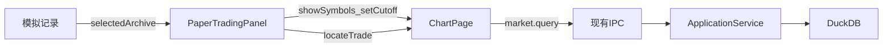

# Sprint5 迭代文档

> 版本：v0.3.5
> 状态：**进行中**
> 关联：[Sprint1 需求文档](../Sprint1/需求文档.md)、[Sprint4 迭代文档](../Sprint4/迭代文档.md)

本迭代只扩展模拟盘「模拟记录」的查看。上半部分仍是归档表，下半部分复用交易页的交易记录列表。点名称后，用这条归档把左侧标的、K 线和交易记录一起装上，交易时间仍可定位到图上。不新增查询协议，不改交易中的下单。

---

## 1. 当前迭代目标

点开一条已归档的模拟记录时，能看到它的每一笔成交，并在原来的图表上对照。

### 1.1 目标声明

| # | 目标 | 验收口径 |
|---|---|---|
| G1 | 模拟记录页分成上下两块 | 上半是现有归档表，下半是和交易页同一套交易记录表；两块各自滚动 |
| G2 | 归档名称可点，并装入这条记录 | 点名称后，左侧列表换成这条记录的标的，图表加载其中第一只的 K 线并停在截止日，下半列出这笔归档的成交 |
| G3 | 查看时的成交能和图表交互 | 点交易时间会切到对应标的并把该日滚到视图中间；当前标的的买卖标记出现在 K 线上。规则与交易页正在进行的记录相同 |
| G4 | 正在进行的模拟不被这次查看冲掉 | 交易中、开始加载中、已结束但还没重置时，名称点了不换标的、不换截止日、不换图上的标记 |

### 1.2 范围边界（本迭代不做）

- 不在模拟记录里改、删归档，也不把归档恢复成可继续下单的交易
- 不改交易页的开始、结束、归档、重置和下单
- 不改模板页
- 不新增数据表，不新增 IPC
- 不改图表页、数据页
- 查看时不开放「下一根」。截止日只用来裁切 K 线，回放不处于进行中
- 旧归档里没有当时的标的列表时，不回填数据库

### 1.3 技术选型（本迭代）

| 层 | 选型 |
|---|---|
| 壳 / 构建 | 现有 Electron，无新进程 |
| UI | MUI。下半复用 `TradeRecords`；名称用和交易时间相同的 `Link` |
| 业务 | 渲染进程。装入记录走图表页已有的 `showSymbols`、`setCutoff`、`setTradeMarkers`、`locateTrade` |
| 数据 / 计算 | 现有 `paper_archive.payload`。新归档多写当时的标的列表 |
| 协议 | 无新 IPC。仍用 `paperArchive.list` / `paperArchive.create` |

---

## 2. 功能需求

### 2.1 用户故事

1. 作为用户，我在模拟记录里同时看到归档一览和某一条的成交明细，不用只靠归档表上的汇总数字。
2. 作为用户，我点一条归档的名称后，左侧出现当时的标的，图表出现对应 K 线，下半出现这笔成交。
3. 作为用户，我点某笔成交的时间，图表切到该标的并定位到那一天，和图上正在交易时的点法一样。
4. 作为用户，我正在交易或暂停在未重置的进度上时，点归档名称不会把当前标的和进度换掉。

### 2.2 功能清单

| ID | 功能 | 优先级 | 状态 |
|---|---|---|---|
| F01 | 模拟记录页上下分栏 | P0 | 已完成 |
| F02 | 归档名称改为链接，选中行高亮 | P0 | 已完成 |
| F03 | 点名称后装入标的、截止日和成交 | P0 | 已完成 |
| F04 | 查看中的成交可定位，并画出买卖标记 | P0 | 已完成 |
| F05 | 交易进行中或未重置时忽略查看 | P0 | 已完成 |
| F06 | 新归档写入当时的标的列表 | P0 | 已完成 |

### 2.3 非功能需求

- 查看只读。不写入 `paper_archive`，不改内存里的持仓、资金和尚未归档的成交
- 交易页的成交列表仍只显示当前这次模拟，不改成正在查看的归档
- 隐藏标的、隐藏时间的规则跟这笔归档的模板走：随机标的且勾了隐藏名称时，左侧和成交里仍用 A、B、C；随机开始且勾了隐藏时间时，成交时间显示「—」且不能点
- 旧记录没有标的列表时仍能打开：指定标的用模板里的列表；随机标的用成交里出现过的代码，按记录顺序去重

---

## 3. 详细设计说明

### 3.1 进程与数据流

查看停在渲染进程。归档列表已经含成交和模板。标的列表从这条记录解出来，再交给图表页现有的会话接口。



主路径：

1. 进入模拟盘时仍调用 `paperArchive.list`，表格数据不变。
2. 点某一行的名称。若当前交易未结束或已结束但未重置，直接返回。
3. 从该记录得到标的、是否遮罩、是否隐藏时间，调用 `showSymbols`。
4. `setCutoff(endedOn)`，`setReplayRunning(false)`。图表按截止日裁切，工具栏的「下一根」保持不可用。
5. 下半部渲染该记录的 `trades`。点时间走 `locateTrade`。
6. 买卖标记改由「正在查看的成交，否则当前交易的成交」计算，仍按当前图表标的过滤。

### 3.2 目录 / 模块（本迭代涉及）

```
src/renderer/src/pages/paper/PaperTradingPanel.tsx
src/shared/types/paperArchive.ts
src/shared/paper/paperArchive.ts
```

图表页的 `showSymbols`、`setCutoff`、`locateTrade`、`setTradeMarkers` 已存在，本迭代不改 `ChartPage`。

### 3.3 数据模型 / 存储

无新表。`paper_archive.payload` 增加当时左侧标的。

| 字段 | 位置 | 内容 |
|---|---|---|
| `symbols` | payload | `{ tsCode, name }[]`，归档瞬间的标的，顺序与左侧列表一致 |
| `template` | payload | 已有。用来判断遮罩和隐藏时间 |
| `trades` | payload | 已有。下半部直接用 |
| `startedOn` / `endedOn` | 表列，并写入 payload | 已有。截止日用来裁切 K 线 |

旧 payload 没有 `symbols` 时读取结果为空数组，不因此判记录无效。

标的恢复顺序：

1. `symbols` 非空，用它。
2. 否则模板是指定标的，用 `template.symbols`。
3. 否则按 `trades` 里首次出现的 `tsCode` 去重，名称用该笔成交上的 `name`。

遮罩不另存：

- `maskSymbol`：`template.symbolSource === 'random' && template.hideSymbol`
- `hideTime`：`template.startMode === 'random' && template.hideStartTime`

### 3.4 协议 / API / IPC

无新通道。

| 调用 | 用途 |
|---|---|
| `paperArchive.list` | 打开页面时取归档，含成交 |
| `paperArchive.create` | 归档时多带 `symbols` |

### 3.5 核心编排

归档：

1. `commitArchive` 现有字段不变。
2. `symbols` 取 `sessionSymbols` 的 `ts_code` 与 `name`。
3. `readPaperArchiveDraft` 接受 `symbols`。缺省或空数组合法。有值时每项必须有非空 `tsCode` 和字符串 `name`。

查看：

1. 记录当前选中的归档 id。再点同一条不重复装载。
2. `showSymbols` 的股票对象：能在已加载的 `stocks` 里命中就用那条，否则用代码和名称组一条列表项。这与开始交易时 `stockFromRef` 的做法相同。
3. 截止日设为 `endedOn`，回放状态设为未进行。
4. 开始交易、重置交易时清掉选中归档。开始交易自己的 `showSymbols` 会换上新标的。

标记：

1. 有选中归档时，用该归档的成交生成标记。
2. 没有选中归档时，仍用交易页内存里的 `trades`。
3. 只保留 `tsCode` 等于当前图表标的、且有时间的成交。同一日同一方向只留一个标记。

### 3.6 UI

**分栏。** 模拟记录页根容器保持撑满右栏。上半、下半各 `flex: 1`，`minHeight: 0`，各自 `overflow: auto`。中间一条 `divider`。上半是现有 `ArchiveRecords`。下半标题为「交易记录」，下面是 `TradeRecords`。

**未选中。** 下半不显示「还没有交易记录」。显示一行次要文字：「选择一条模拟记录」。选中后若该条没有成交，仍用交易表里的「还没有交易记录」。

**名称。** 名称列改为按钮型链接，样式与交易时间链接一致。当前选中行背景用 `action.selected`。

**不可查看。** `trading`、`pendingStart` 或 `breakpoint !== null` 时，名称不是链接，点击无效果。不弹错误。

**图表。** 装入后选中列表第一只。K 线沿用图表页现有查询；截止日把截止日之后的 K 线裁掉。点成交时间时，若代码不同先换标的，再把该日居中。隐藏时间的记录不提供这个点击。

### 3.7 契约

无新 JSON Schema。

| 层级 | 位置 |
|---|---|
| TypeScript | `PaperArchiveDraft.symbols`：`PaperSymbolRef[]` |

---

## 4. 任务步骤

| 步骤 | 任务 | 产出 | 状态 |
|---|---|---|---|
| 1 | 归档读写增加 `symbols`，旧记录缺字段仍可解析 | `paperArchive.ts`、`paperArchive.ts` 类型、归档写入 | 已完成 |
| 2 | 模拟记录页上下分栏，名称可点，选中态 | `PaperTradingPanel.tsx` | 已完成 |
| 3 | 点名称装入标的和截止日；交易中或未重置时忽略 | `PaperTradingPanel.tsx` | 已完成 |
| 4 | 下半成交定位，标记跟查看或当前交易切换 | `PaperTradingPanel.tsx` | 已完成 |
| 5 | 按第 5 节手工走一遍 | 验收记录回填第 5 节 | 待补跑 |

### 4.1 本地复现命令

```bash
npm run dev
```

手工路径：模拟盘用指定标的做一笔买卖并归档 → 重置 → 打开模拟记录，确认上下分栏 → 点名称，看左侧、K 线和成交 → 点成交时间，确认换标的并定位 → 再开始一笔交易，点另一条名称，确认当前进度不变。另用一条随机标的的新归档，确认左侧是当时抽中的标的。

---

## 5. 测试结果 / 总结反馈

### 5.1 验收清单与结果

| 检查项 | 方式 | 结果 | 说明 |
|---|---|---|---|
| G1 上下分栏且各自滚动 | 手工 | 待补跑 | 尚未实现 |
| G2 点名称装入标的、K 线、成交 | 手工 | 待补跑 | 尚未实现 |
| G2 截止日之后的 K 线不显示 | 手工 | 待补跑 | 计划使用现有 `setCutoff` |
| G3 点时间定位 | 手工 | 待补跑 | 计划复用 `locateTrade` |
| G3 当前标的有买卖标记 | 手工 | 待补跑 | 尚未实现 |
| G3 隐藏时间时不能点 | 手工 | 待补跑 | 与交易页同一 `hideTime` |
| G4 交易中或未重置时不装入 | 手工 | 待补跑 | 尚未实现 |
| F06 新归档带标的，旧归档仍能列出 | 手工 | 待补跑 | 尚未实现 |
| 渲染进程类型检查 | `npm run typecheck` | 通过 | 2026-10-25，主进程与渲染进程均无报错 |

### 5.2 关键命令记录

```
npm run typecheck
```

2026-10-25 退出码 0。窗口内的分栏、点名称装入和交易中忽略尚未手工走。

### 5.3 总结反馈

**做得好的地方**

- 成交、定位和截止日裁切都已经在交易流程里，本迭代是把归档重新接到这些入口上。

**暴露的问题 / 摩擦**

- 归档 payload 只有模板和成交。随机标的的实际列表只活在当次会话里，不补记 `symbols` 就无法还原左侧列表。
- 模拟记录和交易共用同一张图。查看如果无条件调用 `showSymbols`，会换掉尚未重置的进度。

---

## 6. 改进目标

### 6.1 短期（下一迭代可做）

1. 模拟记录支持删除一条归档，删除前确认。
2. 查看归档时在右栏上方显示该条的起止日期和总收益率，避免只在上表里读。

### 6.2 中期

1. 只读回放：在归档的开始日和截止日之间逐步走 K 线，不能下单。
2. 旧的随机标的归档无法还原未成交标的。若需要，另做一次数据修复；本迭代不回填。

### 6.3 长期

1. 按归档做收益对照：同一模板的多条记录放在一张表里比较持仓天数和收益率。

---

## 附录

### A. 相关文档

- [Sprint1 需求文档](../Sprint1/需求文档.md)：模拟盘三列、交易记录和归档表的原始范围
- [Sprint4 迭代文档](../Sprint4/迭代文档.md)：数据页分类。本迭代不改那一页

### B. 常用命令

| 命令 | 用途 |
|---|---|
| `npm run dev` | 开发起窗，做本迭代手工验收 |
