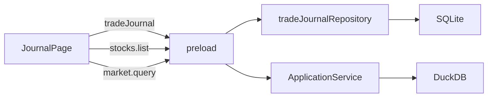

# Sprint6 迭代文档

> 版本：v0.3.6
> 状态：**进行中**
> 关联：[需求文档](./需求文档.md)、[Sprint5 迭代文档](../Sprint5/迭代文档.md)

本迭代新增一页「交易管理」，用来记实际交易的计划、分笔成交和持仓结果。数据进 SQLite。行情只读现有日线，用来算买入的入场首日盈亏和持仓净收益。不改模拟盘，不在图上画这些成交。

---

## 1. 当前迭代目标

用户能新建一张交易记录，在还没下单时写下计划和费用，之后补上分笔买卖，列表按状态和净盈亏查看。

### 1.1 目标声明

| # | 目标 | 验收口径 |
|---|---|---|
| G1 | 侧栏有交易管理页 | 列表列出已保存的记录；上方是过滤和「创建」；没有记录时列表为空 |
| G2 | 创建用全屏对话框，内容固定宽度居中 | 对话框铺满窗口；表单本体宽 960 并水平居中，不跟着 21:9 拉满；创建时不显示状态 |
| G3 | 计划区在创建时能填，保存后不能改 | 息费和交易分析只在创建时可输入；再次打开时这两段为禁用；投后管理在未完成前可改 |
| G4 | 状态由成交和持仓决定 | 没有成交是计划中；有成交且持仓不为 0 是进行中；有成交且持仓为 0 是已完成。已完成的行不能再编辑 |
| G5 | 持仓和净盈亏按成交与本地日线计算 | 持仓数量、均价、总费用、净收益与第 3.5 节公式一致；缺少 K 线时不填一个假数字 |
| G6 | 列表能过滤，行能展开 | 六个过滤条件同时生效；点标的旁的展开图标能看到计划和成交明细 |

### 1.2 范围边界（本迭代不做）

- 不改模拟盘、图表、数据页、仪表盘和配置
- 不新增行情同步，不改 `market.query`
- 不把这些成交画到 K 线上，也不从本页跳到图表
- 不删除整张交易记录
- 不导入、不导出
- 不做一单多标的
- 成交和进场只记到日期，不记时分
- 费用不设最低 5 元，也不把息费做成全局设置。每张表单自己带一套息费
- 纸面表里的出场指令、出场盈亏、出场实际费用、实际成本、净盈亏，以及投后管理里重复的一行进场价、进场时间，不再做成单独输入

### 1.3 技术选型（本迭代）

| 层 | 选型 |
|---|---|
| 壳 / 构建 | 现有 Electron，无新进程 |
| UI | MUI。`Dialog` 用 `fullScreen`；列表用表格；标的用本地股票列表做自动完成 |
| 业务 | 校验、状态、费用和持仓放 `src/shared/tradeJournal/`，渲染进程和主进程共用 |
| 数据 / 计算 | 新表 `trade_journal`，一行一个 JSON。日线沿用 `market.query`，复权固定 `none` |
| 协议 | 新 IPC：`tradeJournal.list` / `create` / `update`。标的用现有 `stocks.list` |

---

## 2. 功能需求

### 2.1 用户故事

1. 作为用户，我在交易管理里看到自己的交易记录，并能按进场时间、标的、方向、交易类型、状态和净盈亏筛选。
2. 作为用户，我点「创建」后写下标的、方向、理由、来源、进场价和费用假设；还没买卖时也可以保存。
3. 作为用户，我给一张未完成的记录追加分笔买入和卖出，看到持仓数量、均价、总费用和净收益。
4. 作为用户，我打开已保存的记录时，计划部分保持当初写下的内容；交易完成后不能再改。

### 2.2 功能清单

| ID | 功能 | 优先级 | 状态 |
|---|---|---|---|
| F01 | 侧栏入口和交易管理页 | P0 | 已完成 |
| F02 | 列表列、展开明细、创建按钮 | P0 | 已完成 |
| F03 | 六个过滤条件 | P0 | 已完成 |
| F04 | 创建对话框：息费、交易分析、自动计算 | P0 | 已完成 |
| F05 | 标的按名称、代码、拼音首字母查询 | P0 | 已完成 |
| F06 | 编辑回填；计划区锁定；已完成不可编辑 | P0 | 已完成 |
| F07 | 分笔买入、卖出，以及未完成时删除单笔 | P0 | 已完成 |
| F08 | 状态、持仓、净收益 | P0 | 已完成 |
| F09 | 入场首日盈亏用成交当日收盘，或改为手填 | P0 | 已完成 |
| F10 | SQLite 与 IPC | P0 | 已完成 |

### 2.3 非功能需求

- 状态、持仓和净收益由成交与行情推导，不另存一份结果，避免和成交对不上
- 成交价是实际价格，日线用 `adjust: 'none'`
- 自动计算失败时留空并说明原因，不用 0 代替
- 个人记录量级，列表一次取全量，过滤在渲染进程做
- 表单在超宽屏上保持 960 宽、水平居中

---

## 3. 详细设计说明

### 3.1 进程与数据流

记录的保存走主进程。行情和股票列表走已经有的通道。净收益在渲染进程里算。



主路径：

1. 打开页面时 `tradeJournal.list`，并 `stocks.list` 供标的查询。
2. 创建或更新只提交用户输入。主进程用 shared 里的校验解析后再写入。
3. 列表拿到记录后，对每个「进行中」的标的查一次日线，取最后一根收盘，再算净收益。
4. 入场首日盈亏在添加该笔买入时，按成交日查一根日线。

### 3.2 目录 / 模块（本迭代涉及）

```
src/shared/types/tradeJournal.ts
src/shared/tradeJournal/tradeJournal.ts
src/main/db/sqlite.ts
src/main/db/tradeJournalRepository.ts
src/main/ipc/registerHandlers.ts
src/preload/index.ts
src/preload/index.d.ts
src/renderer/src/layout/AppShell.tsx
src/renderer/src/App.tsx
src/renderer/src/pages/journal/JournalPage.tsx
src/renderer/src/pages/journal/JournalDialog.tsx
```

`AppPage` 增加 `journal`。侧栏放在「模拟盘」和「数据」之间，提示和无障碍名称都是「交易管理」。

### 3.3 数据模型 / 存储

新表，结构与 `paper_plan` 相同：主键、整份 JSON、时间。

```sql
CREATE TABLE IF NOT EXISTS trade_journal (
  id         TEXT PRIMARY KEY NOT NULL,
  payload    TEXT NOT NULL,
  created_at TEXT NOT NULL,
  updated_at TEXT NOT NULL
);
```

payload 保存输入和自动计算开关，不保存状态、持仓和净收益。

| 块 | 字段 | 说明 |
|---|---|---|
| 息费 | `commissionPct`、`stampTaxPct`、`otherFee` | 百分数的存法与模拟方案相同：`0.05` 表示 0.05%。另两项缺省 `0.05`，其他费用缺省 `0` |
| 交易分析 | `tsCode`、`name`、`side`、`style`、`reason`、`sourceOrg`、`sourcePerson`、`entryPrice`、`entryDate`、`quantity`、`orderType` | `side` 为 `long` / `short`；`style` 为 `left` / `right`；`orderType` 为 `limit` / `market`。日期为 `YYYY-MM-DD` |
| 交易分析 | `entryFee`、`flatExitFee`、`breakevenPrice` 及各自的 `auto` | 勾着自动时，保存当时算出的数；关掉自动时保存手填的数 |
| 投后 | `reasonStillHolds` | 创建时缺省为成立 |
| 买入 | `id`、`tradeDate`、`price`、`quantity`、`fee`、`firstDayPnl`、`firstDayPnlAuto` | 多笔 |
| 卖出 | `id`、`tradeDate`、`price`、`quantity`、`fee` | 多笔 |

图片里有「交易数量」，分段清单没有单独再写。进场费用、原地出场费用和盈亏平衡价都是金额，必须有数量。交易分析因此保留 `quantity`，必填，大于 0。

持仓数量也要逐笔数量。每一笔买入、卖出都有 `quantity`，必填，大于 0。需求正文只写了成交时间、成交价、成交费用；没有这一项就无法汇总持仓。

滑点没有单独输入。界面备注仍写「进场费用=佣金+滑点」。计算时滑点就是「其他费用和」这一笔固定金额。

百分数校验与模拟方案相同：佣金、印花税为 0 到 100。其他费用和成交费用大于等于 0。进场价、成交价大于 0。

标的必须来自 `stocks.list` 里的一条，同时记下 `tsCode` 和 `name`。

交易类型缺省「左侧交易」，入场指令缺省「限价单」。方向没有缺省，必须选择。进场理由可空。信息来源机构和信息来源个人必填。

### 3.4 协议 / API / IPC

| 通道 | 行为 |
|---|---|
| `tradeJournal:list` | 按 `updated_at` 降序返回全部记录 |
| `tradeJournal:create` | 校验草稿，写入，返回带 `id` 的记录 |
| `tradeJournal:update` | 按 `id` 覆盖 payload。已完成的记录拒绝更新 |

没有删除通道。

行情和标的不新增通道：

| 已有调用 | 用途 |
|---|---|
| `stocks.list` | 标的模糊查询 |
| `market.query` | 成交日收盘、进行中仓位的最新收盘 |

`market.query` 的 `limit` 从窗口起点向后截，不能用来表示最新一根。进行中的标的按「今天往前 120 天」到今天查询，`adjust` 为 `none`，取返回序列最后一根的 `close`。这段里没有 K 线时，净收益显示「缺少行情」。

入场首日用 `start_date` 和 `end_date` 都等于该笔成交日，取这一根的 `close`。

### 3.5 核心编排

费率先除以 100 再参加计算。下面用 `c` 表示佣金率，`t` 表示印花税率，`o` 表示其他费用，`P` 表示进场价，`Q` 表示交易数量。印花税只加在卖出一侧。

**进场费用**，自动打开时：

- 做多：`P × Q × c + o`
- 做空：进场是卖出，`P × Q × c + P × Q × t + o`

**原地出场费用**，按进场价平掉这笔计划数量：

- 做多：平仓是卖出，`P × Q × c + P × Q × t`
- 做空：平仓是买入，`P × Q × c`

**盈亏平衡价**。做多时，以价格 `X` 卖出的总额，减去买卖费用，再减进场总额，结果为 0：

`X = (P × Q × (1 + c) + o) / (Q × (1 - c - t))`

做空时，用买入回补价 `X` 使同样的差额为 0：

`X = (P × Q × (1 - c - t) - o) / (Q × (1 + c))`

分母小于等于 0，或做空时分子小于 0，自动结果为空，并提示无法计算。关掉自动后，保留当时的数字作为手填起点，之后不再覆盖。

这三项只在创建时随息费、价格、数量、方向重算。保存后再打开，直接显示已存的数，不再重算。

**持仓**。成交按日期排序，同一天保持添加顺序。做多时买入加仓、卖出减仓。做空时卖出加仓、买入减仓。减仓数量不能超过当时持仓，超出的一笔不能加入。

持仓平均成本只按成交价做数量加权，费用不摊进均价。加仓时：

`(原数量 × 原均价 + 新数量 × 成交价) / 新的总数量`

减仓不改变剩余仓位的均价。没有持仓时均价为空。

交易产生的总费用是全部成交费用之和。计划里的进场费用和原地出场费用是假设，不计入总费用。

**净收益** = 已实现盈亏 + 浮动盈亏 − 总费用。

- 做多，卖出已实现：`(卖出价 − 当时均价) × 卖出数量`
- 做空，买入回补已实现：`(当时均价 − 买入价) × 买入数量`
- 做多浮动：`(最新收盘 − 均价) × 持仓数量`
- 做空浮动：`(均价 − 最新收盘) × 持仓数量`
- 持仓为 0 时浮动为 0，不再查最新收盘

没有成交时净收益为空，列表显示「—」。进行中但 120 天内没有收盘价时，显示「缺少行情」。

**入场首日盈亏**只放在买入记录上。

- 做多：`(当日收盘 − 成交价) × 成交数量`
- 做空：`(成交价 − 当日收盘) × 成交数量`

做空时买入是回补，这个数只表示该笔在成交当日按收盘计价的盈亏。当日没有 K 线时，这一笔不能在自动打开的状态下保存，提示缺少该日行情；关掉自动后可以手填，允许为负。

**状态**在读取和保存时用同一函数计算：

| 条件 | 状态 |
|---|---|
| 没有任何买入或卖出 | 计划中 |
| 有成交，且持仓数量大于 0 | 进行中 |
| 有成交，且持仓数量等于 0 | 已完成 |

保存后持仓变为 0 时，先确认「保存后变为已完成，不能再改」。取消则不写入。

### 3.6 UI

**页面。** 工具栏在列表上方。左侧是过滤，右侧是带加号图标和文字「创建」的按钮。列表撑满剩余高度并单独滚动。

**列，从左到右。** 标的名称和代码，旁边是展开图标；进场时间；方向；交易类型；状态；净盈亏；编辑图标按钮。默认按进场时间从新到旧。

**展开。** 进场理由、来源机构、来源个人、进场价、交易数量、盈亏平衡价、持仓数量、持仓均价、总费用，以及买入列表、卖出列表。

**过滤，同时生效。**

| 条件 | 行为 |
|---|---|
| 进场时间 | 起止日期，含两端 |
| 标的 | 名称、代码包含，并走 `matchesStockQuery` 的拼音首字母 |
| 方向 | 全部 / 做多 / 做空 |
| 交易类型 | 全部 / 左侧交易 / 右侧交易 |
| 状态 | 全部 / 计划中 / 进行中 / 已完成 |
| 净盈亏 | 最小、最大。净盈亏还没有数的行，在设置了这个条件时不出现 |

**对话框。** `fullScreen`。内部一块 960 宽的内容水平居中，超宽屏两侧留空。窄于 960 时对话框内部横向滚动，不把字段拉满窗口。内容分三段：息费、交易分析、投后管理。两列网格，进场理由占两列。

创建时不显示状态。编辑时在顶部显示状态文字。

息费和交易分析在编辑时全部禁用，含三个自动计算项。投后管理在计划中和进行中可改：理由是否仍成立、追加买入、追加卖出、删除某一笔。已完成的编辑按钮禁用，提示「已完成的交易不能修改」。

自动计算的勾选缺省打开，打开时对应输入框不可编辑。备注用需求里的三句：「进场费用=佣金+滑点」「以入场价出场产生的费用」「加入买入和原地卖出费用后得出的价格」。

标的输入后按 `matchesStockQuery` 过滤 `stocks.list`，选项显示「名称 代码」。

买入、卖出各自一个按钮。点开后在按钮下填写一笔，确认后进入该侧列表。买入多一个入场首日盈亏。创建时可以一笔都不加。

投后管理里的持仓四项是文字，不是输入框。创建且还没有成交时：持仓数量 0，均价「—」，总费用 0，净收益「—」。

### 3.7 契约

无新 JSON Schema。校验放在 shared，和模拟方案一样。

| 层级 | 位置 |
|---|---|
| TypeScript | `src/shared/types/tradeJournal.ts`、`src/shared/tradeJournal/tradeJournal.ts` |

---

## 4. 任务步骤

| 步骤 | 任务 | 产出 | 状态 |
|---|---|---|---|
| 1 | 草稿类型、校验、费用、持仓、状态 | `tradeJournal.ts` 类型与 pure functions | 已完成 |
| 2 | 建表、仓储、IPC、preload | `sqlite.ts`、`tradeJournalRepository.ts`、`registerHandlers.ts`、preload | 已完成 |
| 3 | 侧栏入口、列表、过滤、展开 | `AppShell.tsx`、`App.tsx`、`JournalPage.tsx` | 已完成 |
| 4 | 创建对话框和三项自动计算 | `JournalDialog.tsx` | 已完成 |
| 5 | 编辑锁定、分笔成交、日线和净收益 | `JournalDialog.tsx`、`JournalPage.tsx` | 已完成 |
| 6 | 按第 5 节手工走一遍 | 验收记录回填第 5 节 | 待补跑 |

### 4.1 本地复现命令

```bash
npm run dev
```

手工路径：打开交易管理，创建一张不做买卖的记录，确认状态为计划中且计划区已锁定 → 追加买入，确认进行中，首日盈亏能对上该日收盘 → 再卖到持仓为 0，确认后变为已完成且不能编辑 → 用过滤和展开看这三条。另做一张做空，核对进场费用里含印花税、平衡价低于进场价。

---

## 5. 测试结果 / 总结反馈

### 5.1 验收清单与结果

| 检查项 | 方式 | 结果 | 说明 |
|---|---|---|---|
| G1 页面和空列表 | 手工 | 待补跑 | 代码已接上侧栏，窗口里还没走 |
| G2 全屏对话框、960 居中 | 手工 | 待补跑 | 窗口里还没走 |
| G3 创建可填，编辑后计划区禁用 | 手工 | 待补跑 | 窗口里还没走 |
| G4 三种状态，已完成不能编辑 | 手工 | 待补跑 | 纯函数已覆盖三种状态；按钮禁用还没在窗口里看 |
| G5 费用、平衡价、持仓、净收益 | 脚本 + 手工 | 脚本通过，手工待补跑 | 2026-10-26，做多样例与第 3.5 节一致；窗口里还没对过 K 线 |
| G5 缺少 K 线时不显示假 0 | 手工 | 待补跑 | 窗口里还没走 |
| G6 过滤与展开 | 手工 | 待补跑 | 窗口里还没走 |
| 做空的费用和平衡价 | 脚本 + 手工 | 脚本通过，手工待补跑 | 进场费含印花税，平衡价 9.985 低于进场价 10 |
| 减仓超过持仓被拒绝 | 脚本 + 手工 | 脚本通过，手工待补跑 | `closingFillError` 返回「减仓数量不能超过持仓」 |
| 主进程与渲染进程类型检查 | `npm run typecheck` | 通过 | 2026-10-26，退出码 0 |

### 5.2 关键命令记录

```
npm run typecheck
```

2026-10-26 退出码 0。

同一天用样例核对了纯函数。做多：进场价 10、数量 100、佣金和印花税都是 0.05%、其他费用 0。进场费用 0.5，原地出场费用 1，盈亏平衡价 10.015015。买入 100 股后再卖 40 股，持仓 60、均价 10、已实现 80、总费用 2；最新收盘 11 时净收益 138。做空同一组息费：进场费用 1，原地出场费用 0.5，盈亏平衡价 9.985007。卖出 101 股被拒绝。

窗口里的创建、编辑、过滤和行情对照还没走。

### 5.3 总结反馈

**做得好的地方**

- 模拟方案已经有「百分数 + JSON 一行」的存法，股票模糊查询和日线查询也都在，本迭代不用新开行情通道。

**暴露的问题 / 摩擦**

- 分段清单没有交易数量和每笔成交数量，金额和持仓都算不出来。本文按图片和计算需要把这两项加回。
- 备注里的滑点没有独立输入，计算时把它定为「其他费用和」。
- 需求写的平衡价句子是做多平仓。做空要用回补价，公式已在第 3.5 节分开。
- 编辑一开始就锁定计划区。记错进场价时，只要保存过就不能改。
- 持仓卖到 0 就会变成已完成并锁死。最后一笔若记错，只能在确认前取消。
- `market.query` 的 `limit` 不能取最新收盘，净收益要取窗口里的最后一根。

---

## 6. 改进目标

### 6.1 短期（下一迭代可做）

1. 计划中的记录仍允许改息费和交易分析。
2. 计划中的整张记录可以删除，删除前确认。
3. 已完成的记录可以打开只读对话框，而不只靠行内展开。

### 6.2 中期

1. 从一条记录跳到图表，并标出成交日。
2. 成交费用按当前息费预填，仍可手改。
3. 进行中的标的变多后，只取每个标的最近一根收盘，避免每次拉 120 天。

### 6.3 长期

1. 同一标的的模拟归档和这张实盘记录放在一起对照进场价与实际成交。
2. 导出交易记录。

---

## 附录

### A. 相关文档

- [需求文档](./需求文档.md)：本迭代的范围和纸面表
- [Sprint5 迭代文档](../Sprint5/迭代文档.md)：模拟记录的查看。本迭代不改那一页
- [交易记录表](./交易记录表.png)：纸面字段

### B. 常用命令

| 命令 | 用途 |
|---|---|
| `npm run dev` | 开发起窗，做本迭代手工验收 |
| `npm run typecheck` | 实现后检查主进程和渲染进程类型 |
