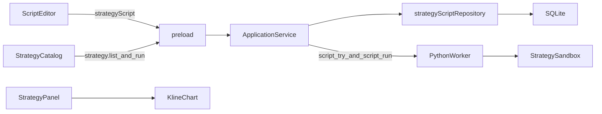

# Sprint7 迭代文档

> 版本：v0.3.7
> 状态：**进行中**
> 关联：[需求文档](./需求文档.md)、[Sprint6 迭代文档](../Sprint6/迭代文档.md)、[商流链](../../v0.2/release文档.md)

在图表页的脚本编辑器里编写策略，解析后存进 SQLite，再进现有策略列表。选中执行后，仍用现在的参数表单、买卖统计和主图标记。指标脚本的编辑、保存和画线不变。内置 `MingSystemVer1`、`MingSystemVer2` 不改写法。

需求原文把两个内置类都写成了 `MingSystemVer1`。代码里第二个是 [`MingSystemVer2`](../../../../python/worker/strategies/MingSystemVer2.py)。

---

## 1. 当前迭代目标

用户用和指标相同的编辑器写下策略，保存后能在策略目录里选中它，在现有策略面板上调参并执行，主图出现买卖标记。

### 1.1 目标声明

| # | 目标 | 验收口径 |
|---|---|---|
| G1 | 编辑器能新建、修改、测试、保存策略脚本 | 策略模板可跑通测试；语法或信号列错误时标出源码行；保存后列表里能再打开 |
| G2 | 保存结果进现有策略目录 | 目录里同时有两个内置策略和用户策略；用户策略展示标题和解析出的参数；内置项不能编辑、不能删除 |
| G3 | 执行走现有策略面板 | 参数表单按声明画出整数、小数、枚举；执行后统计、买/卖/混合列表、主图标记与现在的内置策略相同 |
| G4 | 用户脚本只写声明和买卖算法 | 脚本里读不到行情库；K 线由宿主注入；输出行含 `time` / OHLCV / `buy_signal` / `sell_signal` |
| G5 | 指标链路保持原样 | 指标的新建、测试、保存、添加到图表、设置对话框仍按现在的行为工作 |

### 1.2 范围边界（本迭代不做）

- 不把 `MingSystemVer1`、`MingSystemVer2` 改成脚本，也不改它们的 `declared_default`
- 不把策略画成指标线，脚本里没有 `plot`
- 不让用户脚本自己查 DuckDB
- 不做收益、仓位、回测资金曲线，也不接入模拟盘
- 策略参数不加布尔。面板现有控件是整数、小数、枚举
- 编辑器里的测试不往主图打标记。标记只来自策略面板的执行
- 不合并 `indicator_script` 和策略脚本表
- 用户脚本之间不能互相 import
- 一次仍只选一个策略，不改复盘表的筛选和播放

### 1.3 技术选型（本迭代）

| 层 | 选型 |
|---|---|
| 壳 / 构建 | 现有 Electron 与 Python worker。用户源码仍在子进程里执行 |
| UI | 现有脚本编辑器增加种类。策略目录仍在图表页的指标/策略对话框 |
| 业务 | 声明收集和信号校验放 Python。目录合并、按 id 分发执行放 `ApplicationService` |
| 数据 / 计算 | 新表 `strategy_script`。行情沿用现有日线查询和复权，再把表交给 `compute` |
| 协议 | 新 worker 方法 `strategy.script_try`、`strategy.script_run`。`strategy.list` / `strategy.run` 的现有形状不改 |

---

## 2. 功能需求

### 2.1 用户故事

1. 作为用户，我在脚本编辑器里新建一份策略，写下可调参数和买卖条件，测试通过后保存。
2. 作为用户，我在策略目录里看到这份策略，和两个内置策略排在一起，并能改源码或删除。
3. 作为用户，我选中它之后，在策略面板里改参数并执行，看到买卖数量、信号列表，以及主图上的买卖标记。
4. 作为用户，我继续用原来的方式编写和加载指标，不因为多了策略而改步骤。

### 2.2 功能清单

| ID | 功能 | 优先级 | 状态 |
|---|---|---|---|
| F01 | 策略脚本基类、`param` 声明、信号列校验 | P0 | 已完成 |
| F02 | 子进程试运行与正式运行 | P0 | 已完成 |
| F03 | `strategy_script` 表和仓库 | P0 | 已完成 |
| F04 | 试运行、保存、更新、删除的 IPC | P0 | 已完成 |
| F05 | `strategy.list` 合并用户策略；执行按 id 分发 | P0 | 已完成 |
| F06 | 编辑器按指标/策略切换模板、列表和保存 | P0 | 已完成 |
| F07 | 策略目录里新建、编辑、删除用户策略 | P0 | 已完成 |
| F08 | 面板执行用户策略并画出买卖标记 | P0 | 已完成 |
| F09 | 策略示例模板 | P0 | 已完成 |

### 2.3 非功能需求

- 用户源码不在 worker 主进程里 `exec`，走独立子进程，超时与指标脚本同为 10 秒
- 子进程允许 `pandas`、`numpy`、`math`、`typing`、`collections`。不允许 `open`、`exec`、`eval`、DuckDB、网络和 `worker.db`
- 参数缺省只有解析结果一份。面板和执行都读这份声明
- 买卖列缺失或长度对不上时，测试和执行失败并指向源码，不用全 `false` 代替
- 无 K 线时，编辑器测试返回「当前窗口没有K线」；面板执行返回空序列和 0 计数，与现在的内置策略一致
- 删除当前正打开的用户策略时，清掉面板和主图标记

---

## 3. 详细设计说明

### 3.1 进程与数据流

编辑器负责写下源码。主进程负责保存，并决定这次调用的是内置策略还是用户脚本。Python 只接收源码和已经取好的 K 线，不读策略表。



主路径：

1. 新建策略时，编辑器装入示例源码。测试不带行情时只解析，带回参数声明。测试带当前图表窗口时再计算，编辑器只显示买入、卖出和 K 线数量。
2. 保存时主进程再解析一次。失败则不入库。成功后写入 `strategy_script`。
3. 打开策略目录时，worker 的 `strategy.list` 仍只返回两个内置项。主进程把用户策略接在后面，组成同一份 `StrategyInfo` 列表。
4. 执行时，id 属于内置注册表就走现有 `strategy.run`。id 以 `script:` 开头就从 SQLite 取出源码，调用 `strategy.script_run`。两边都回到现在的 `{ stats, series }`。
5. 策略面板和主图标记不区分来源。

商流链上的分工：

| 环节 | 本迭代职责 |
|---|---|
| Script | 用户源码声明参数，并在给定的日线表上写下买卖列。不读库，不画图 |
| Protocol | 子进程执行；把表收成现有的 `stats + series`；把声明收成现有的 `StrategyParam` |
| UI Controller | 编辑器按种类切换模板和 IPC；目录把内置策略和用户策略列在一起 |
| Chart | 继续用现有买卖标记和复盘列表 |

### 3.2 目录 / 模块（本迭代涉及）

```
python/worker/strategies/script_base.py       StrategyScript、param
python/worker/strategies/sandbox.py           子进程加载和执行
python/worker/strategies/example_strategy.py  编辑器示例源码
python/worker/handlers/strategy_script.py     strategy.script_try / strategy.script_run
python/worker/main.py                         注册上述两个方法
src/shared/types/strategyScript.ts
src/main/db/sqlite.ts                         strategy_script 表
src/main/db/strategyScriptRepository.ts
src/main/ipc/registerHandlers.ts
src/main/services/applicationService.ts       合并列表、按 id 分发
src/preload/index.ts
src/preload/index.d.ts
src/renderer/src/pages/ChartPage.tsx
src/renderer/src/pages/chart/IndicatorDialog.tsx
src/renderer/src/pages/chart/scriptEditor/ScriptEditorPanel.tsx
src/renderer/src/pages/chart/StrategyPanel.tsx   卖出数量的中文标签
```

[`Strategy.py`](../../../../python/worker/strategies/Strategy.py)、[`params.py`](../../../../python/worker/strategies/params.py)、[`MingSystemVer1.py`](../../../../python/worker/strategies/MingSystemVer1.py)、[`MingSystemVer2.py`](../../../../python/worker/strategies/MingSystemVer2.py) 保持不动。指标沙箱 [`python/worker/indicators/sandbox.py`](../../../../python/worker/indicators/sandbox.py) 不放宽导入。

### 3.3 参数声明

策略脚本使用 `param`。指标的 `input` 留在指标里。

两边现在的差别：

| | 指标 | 内置策略 | 用户策略 |
|---|---|---|---|
| 写法 | `inputs()` 里调用 `input.int` / `float` / `bool` | 类体上的 `StrategyParam` 元组，再用 `declared_default` 取缺省 | `declare()` 里调用 `param.int` / `float` / `enum` |
| 解析结果 | `ParamField`，参数包在 `{ inputs, styles }` | `StrategyParam`，扁平字典 | 同内置策略，仍是 `StrategyParam` |
| 谁消费 | 指标设置和 `plot` | 策略面板、`coerce_parameters` | 同一套策略面板 |

不把指标的 `input` 引进策略类。`input` 带布尔和线型样式，没有枚举。明氏策略的「收−开 / 收−低」是枚举，策略面板也只画整数、小数、枚举。共用 `input` 会让策略声明和面板对不上。

也不让用户在脚本里手写 `StrategyParam` 元组再写一遍类属性。那是内置类能在不读 K 线时就被 `strategy.list` 扫到的写法，放进编辑器容易两处脱节，也和指标「函数声明、赋值到 self」的习惯不一致。

用户脚本在声明阶段收集参数，形态接近指标，产物与内置策略相同：

```python
class Breakout(StrategyScript):
    def declare(self):
        self.period = param.int(20, "突破周期", min=2)
        self.k = param.float(0.6, "系数", min=0)
        self.range_mode = param.enum(
            "co",
            "波幅",
            options=(("co", "收−开"), ("cl", "收−低")),
        )

    def compute(self, daily):
        high_prev = daily["high"].shift(1).rolling(self.period).max()
        low_prev = daily["low"].shift(1).rolling(self.period).min()
        out = daily.copy()
        out["buy_signal"] = out["close"] > high_prev
        out["sell_signal"] = out["close"] < low_prev
        return out

strategy = Breakout
```

约定：

- 导出名是 `strategy`，且必须是 `StrategyScript` 的子类。对应指标源码里的 `indicator`
- 声明方法叫 `declare`。基类上的 `parameters` 仍然是元组，避免同名挡住它
- `declare` 可以不写，表示没有参数
- 赋值时记下 `StrategyParam`，并把缺省或本次传入的值写到实例上。未知键、类型不对、越界、枚举不在选项里，都按现有 `coerce_parameters` 拒绝
- 枚举至少有一个选项，缺省必须落在选项里
- 目录上的名称用编辑器里的标题。源码不必再写 `title`
- 不提供 `param.bool`

内置两个类继续用 `declared_default`。它们已经能被 `strategy.list` 和策略面板使用，本迭代不改算法。

### 3.4 计算与输出

`StrategyScript` 把读数、计数和序列组装固定在基类里。用户只实现 `declare` 和 `compute`。调用顺序仍是读数、计算、计数、输出，和 [`StrategyClass.run`](../../../../python/worker/strategies/Strategy.py) 一致。明氏策略里的 `read_data` 自己访问数据库；这一步收到宿主，用户脚本才进得了沙箱。

宿主读数与明氏策略相同：按标的和区间取不复权日线，再用锚点复权系数得到本次 `adjust` 下的价格。交给 `compute` 的是 `pandas.DataFrame`，索引为 `trade_date`（`YYYYMMDD`），列至少有 `open`、`high`、`low`、`close`、`vol`。

`compute` 可以改传入的表，也可以返回一张新表。基类在返回值不是 `None` 时用返回值。结束后必须有与索引对齐的 `buy_signal`、`sell_signal`。空值按 `false`。用户另加的列保留进序列，复盘表能看见，和明氏策略带出 `wr` 等列的方式相同。

基类组装的序列字段与 [`strategy.run.response`](../../../../contracts/strategy.run.response.json) 一致：`time`、`open`、`high`、`low`、`close`、`vol`、`buy_signal`、`sell_signal`。`time` 为八位日期。`stats` 保留 `buy_count`、`bar_count`，并增加 `sell_count`。现有 schema 允许统计上的附加字段。内置策略的 `strategy.run` 仍只回这两个原有计数。面板为 `sell_count` 增加标签「卖出信号数量」。

### 3.5 数据模型 / 存储

新表，不复用 `indicator_script`。指标布局按那张表的 id 引用脚本，两边的 manifest 也不一样。

```sql
CREATE TABLE IF NOT EXISTS strategy_script (
  id         TEXT PRIMARY KEY NOT NULL,
  title      TEXT NOT NULL,
  source     TEXT NOT NULL,
  manifest   TEXT NOT NULL,
  updated_at TEXT NOT NULL
);
```

`manifest` 只存参数数组，元素与 `StrategyParam.to_dict()` 相同。表内 id 是 uuid。对外的策略 id 是 `script:` 加这个 uuid，避免和 `ming_system_ver1`、`ming_system_ver2` 相撞。

### 3.6 协议 / IPC

Worker 新方法：

| 方法 | 请求 | 成功时的结果 |
|---|---|---|
| `strategy.script_try` | `source`；可选 `params`；可选 `query` | `ok`、参数 `manifest`。带 `query` 且有 K 线时另给 `buy_count`、`sell_count`、`bar_count` |
| `strategy.script_run` | `source`、`ts_code`、`start_date`、`end_date`、`adjust`、可选 `params` | 与 `strategy.run` 相同的 `stats` 和 `series`。`strategy_id` 由主进程填回 `script:<uuid>` |

失败形态与指标试运行相同：`ok: false`、`error`、`traceback`、`line`、`column`。不往主进程抛用户源码异常。

IPC：

| 通道 | 作用 |
|---|---|
| `strategyScript:list` | 返回已保存策略的 id、标题、源码、manifest、更新时间 |
| `strategyScript:exampleSource` | 返回示例源码 |
| `strategyScript:try` | 转发 `strategy.script_try` |
| `strategyScript:create` | 解析通过后插入 |
| `strategyScript:update` | 改标题或源码时重新解析 |
| `strategyScript:remove` | 删除。没有布局引用检查 |
| `strategy:list` | 通道名不变。主进程把用户策略接在内置列表之后 |
| `strategy:run` | 通道名不变。`script:` 前缀改走 `strategy.script_run` |

`contracts/strategy.run.request.json` 和 `strategy.run.response.json` 本迭代不改。用户策略的执行结果由主进程套进现有响应类型。

### 3.7 UI

编辑器仍是现在的 [`ScriptEditorPanel`](../../../../src/renderer/src/pages/chart/scriptEditor/ScriptEditorPanel.tsx) 和 [`ScriptSourceEditor`](../../../../src/renderer/src/pages/chart/scriptEditor/ScriptSourceEditor.tsx)。增加种类 `indicator | strategy`。

- 新建菜单分成「新建指标」和「新建策略」
- 列表只显示当前种类
- 未保存的草稿切换种类时换上对应模板
- 已保存脚本的种类不能改
- 策略测试的成功提示写明买入数、卖出数、K 线数；不调用图表上的策略标记

策略目录在 [`IndicatorDialog`](../../../../src/renderer/src/pages/chart/IndicatorDialog.tsx) 的策略页。

- 内置项保持现在的添加按钮
- 用户项增加编辑和删除，交互对齐指标脚本那一列
- 页上提供「新建策略」，打开策略种类的编辑器
- 添加后仍进入现有 [`StrategyPanel`](../../../../src/renderer/src/pages/chart/StrategyPanel.tsx)。参数区已经按 `int` / `float` / `enum` 画表单，用户策略不再做第二套表单

更新一份正在选中的用户策略后，面板上的参数声明换成新的 manifest。删除这份正在选中的策略时关闭面板并清掉标记。

### 3.8 示例模板

示例不复制明氏策略。它用一个整数参数标出收盘突破前高、跌破前低：

```python
class Breakout(StrategyScript):
    def declare(self):
        self.period = param.int(20, "突破周期", min=2)

    def compute(self, daily):
        high_prev = daily["high"].shift(1).rolling(self.period).max()
        low_prev = daily["low"].shift(1).rolling(self.period).min()
        out = daily.copy()
        out["buy_signal"] = out["close"] > high_prev
        out["sell_signal"] = out["close"] < low_prev
        return out

strategy = Breakout
```

周期不足的前几根，滚动结果为空，基类把空信号当成 `false`。

---

## 4. 任务步骤

| 步骤 | 任务 | 产出 | 状态 |
|---|---|---|---|
| 1 | `param` 与 `StrategyScript`：声明阶段、`compute` 契约、信号列校验 | `script_base.py` | 已完成 |
| 2 | 策略沙箱和示例源码 | `sandbox.py`、`example_strategy.py` | 已完成 |
| 3 | `strategy.script_try`、`strategy.script_run`，并在 worker 注册 | `strategy_script.py`、`main.py` | 已完成 |
| 4 | `strategy_script` 表和仓库 | `sqlite.ts`、`strategyScriptRepository.ts` | 已完成 |
| 5 | IPC、列表合并、执行分发 | `registerHandlers.ts`、`applicationService.ts`、preload | 已完成 |
| 6 | 编辑器种类、策略目录的新建/编辑/删除 | `ScriptEditorPanel.tsx`、`IndicatorDialog.tsx`、`ChartPage.tsx` | 已完成 |
| 7 | 卖出数量标签；选中项在更新和删除后的同步 | `StrategyPanel.tsx`、`ChartPage.tsx` | 已完成 |

### 4.1 本地复现命令

```bash
npm run dev
```

`npm run typecheck` 已通过。图表页仍按第 5 节清单手工走通。本迭代没有单独的验收脚本。

---

## 5. 测试结果 / 总结反馈

### 5.1 验收清单与结果

| 检查项 | 方式 | 结果 | 说明 |
|---|---|---|---|
| G1 新建、测试、保存、再打开 | 手工 | 待补跑 | 代码已接上编辑器和 `strategyScript` IPC，尚未在窗口里点过 |
| G1 错误能定位到源码行 | 脚本 | 通过 | 沙箱里缺 `buy_signal` 报 `compute must set buy_signal (line 2)`；语法错误报第 1 行 |
| G2 目录含两个内置策略和用户策略 | 手工 | 待补跑 | `listStrategies` 已把用户策略接在 worker 列表之后，尚未在窗口里看 |
| G2 内置策略不能编辑或删除 | 手工 | 待补跑 | 目录只给 `script:` 前缀的项画编辑和删除 |
| G3 参数表单、统计、列表、主图标记 | 手工 | 待补跑 | 面板仍走原来的执行和标记；`sell_count` 已加中文标签 |
| G4 脚本不能访问行情库 | 脚本 | 通过 | 用户源码 `import duckdb` 被拒绝：`import 'duckdb' is not allowed` |
| G5 指标新建、保存、加到图表 | 手工 | 待补跑 | 指标回调未改路径，尚未在窗口里回归 |
| 无 K 线时测试与执行的两种结果 | 代码检查 | 待补跑 | 试运行空窗口返回「当前窗口没有K线」；正式执行返回 0 计数。未对真实库跑 |
| 删除正在使用的用户策略会清标记 | 手工 | 待补跑 | 删除选中项会调用原来的 `closeStrategyPanel` |

### 5.2 关键命令记录

2026-10-27，在 `python/` 下用项目虚拟环境跑了沙箱，并跑了 `npm run typecheck`。

```
DECLARE ok, parameters[0].title = 突破周期
TRY  buy_count=9 sell_count=0 bar_count=30
RUN_ERR compute must set buy_signal (line 2)
SYNTAX line 1
BLOCK import 'duckdb' is not allowed
registered strategy.script_try strategy.script_run
typecheck exit 0
```

窗口里的保存、目录和主图标记还没有点过。

### 5.3 总结反馈

**做得好的地方**

- 现有策略面板、序列契约和主图标记可以原样接住用户策略，不必再做一套展示
- 指标编辑器已经具备源码、试运行报错和保存，策略只增加种类和另一套接口

**暴露的问题 / 摩擦**

- 需求里的类名写重了，实现以 `MingSystemVer1` 和 `MingSystemVer2` 为准
- 指标 `input` 和策略 `declared_default` 的控件、参数包、读取时机都不同。用户脚本若直接搬 `input`，枚举和现有面板对不上；若要求用户手写 `StrategyParam` 元组，又和编辑器里的指标写法不一致
- 明氏策略的 `read_data` 自己访问数据库。用户脚本若延续这一步，沙箱就得开放行情库，Script 和 Protocol 会重新耦在一起

---

## 6. 改进目标

### 6.1 短期（下一迭代可做）

1. 编辑器测试通过后，允许把这次买卖点临时画到主图，关闭或未保存时清掉
2. 内置策略的统计也返回 `sell_count`，和用户策略对齐
3. 为策略脚本补一条可重复跑的验收，覆盖解析失败、保存、列表合并和空窗口

### 6.2 中期

1. 策略脚本能调用已经保存的指标计算，避免两边各写一套均线
2. 评估是否增加布尔参数，以及策略面板相应的控件
3. 用户策略的参数缺省改完后能记住，下次打开面板不用重填

### 6.3 长期

1. 在买卖点之上做收益和仓位，再考虑和模拟盘或交易记录衔接
2. 一次对多只标的跑同一份策略脚本
3. 脚本之间的库引用。那是商流链里 Script 系统的下一种原料，不放进本迭代

---

## 附录

### A. 相关文档

- [需求文档](./需求文档.md)
- [Sprint6 迭代文档](../Sprint6/迭代文档.md)
- [v0.2 商流链](../../v0.2/release文档.md)
- [Script 系统架构](../../v0.2/Script系统架构.md)
- [策略执行响应契约](../../../../contracts/strategy.run.response.json)

### B. 常用命令

| 命令 | 用途 |
|---|---|
| `npm run dev` | 开发起窗，手工验收图表页 |
