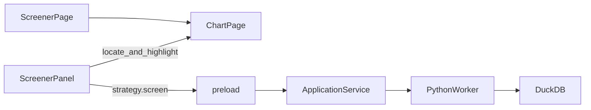

# Sprint8 迭代文档

> 版本：v0.3.8
> 状态：**进行中**
> 关联：[需求文档](./需求文档.md)、[Sprint7 迭代文档](../Sprint7/迭代文档.md)、[商流链](../../v0.2/release文档.md)

本迭代新增一页「选股」。布局沿用模拟盘的三列：左边标的列表，中间 K 线，右边控制面板。打开时左列和主图都是空的，和模拟盘一样。执行时对本地全部股票一次读出行情，只计算所选那一天的买卖信号。算完后左列才出现当天有信号的标的，图表定位到这一天，并用整列背景标出这根 K 线。

---

## 1. 当前迭代目标

用户选定某一天和一份策略，对本地全部股票做一次选股。执行前左列和主图保持空白；执行后只看到有信号的标的，并在图上标出这一天的 K 线。

### 1.1 目标声明

| # | 目标 | 验收口径 |
|---|---|---|
| G1 | 侧栏有选股页，三列与模拟盘同构 | 打开时左列没有标的、主图没有 K 线；右列从上到下是数据截止日期、常开月历、策略选择、执行按钮 |
| G2 | 数据截止日期来自本地日线，月历不能越过它 | 截止日期等于 `market.coverage` 的 `max_date`；没有日线时显示「尚无日线」，月历和执行都不可用 |
| G3 | 一次读出全部股票的行情，只留信号日 | 本地股票列表的 `ts_code` 进一次查询；返回里只有信号日当天的买或卖；不按标的逐次调用 `strategy.run` |
| G4 | 结果落到左列和主图 | 执行后左列只出现当天有信号的标的，并加载其中一只的 K 线；点中一只后，主图滚到所选日，该根 K 线有整列背景；没有信号时左列给出空说明，主图仍不加载 K 线 |

### 1.2 范围边界（本迭代不做）

- 不改模拟盘、图表页、交易管理、数据页、仪表盘和配置
- 不改 `strategy.run` / `strategy.script_run` 的单标的、全序列形状
- 不提供策略参数表单。执行使用该策略已声明的缺省值
- 不把选股结果写入 SQLite，也不导入、导出
- 不把选股结果送进模拟盘
- 不扫描一段时间，只算月历上的那一天
- 不把指数当作选股标的。窗口里若出现指数代码，跳过
- 读数在信号日截止，不把信号日之后的 K 线送进算法
- 读数窗口是信号日往前 400 个自然日，不是从 `20060101` 起的全历史。滚动窗口长于这段的用户脚本，这一天的结果可以和图表页全历史执行不同
- 不新增行情同步

### 1.3 技术选型（本迭代）

| 层 | 选型 |
|---|---|
| 壳 / 构建 | 现有 Electron 与 Python worker。不新增日期组件包 |
| UI | 选股页复用 `ChartPage` 三列。月历用 MUI 自绘，常开，不使用会收起的 `input type="date"` |
| 业务 | 窗口、校验和「只取信号日」放主进程与 worker。页面只提交范围、日期和策略 id |
| 数据 / 计算 | 新 worker 方法 `strategy.screen`。一次 SQL 读出窗口内标的在读数区间里的日线，复权口径与 `load_strategy_frame` 相同 |
| 协议 | 新 IPC `strategy.screen`。`strategy.list` 继续提供内置策略和用户策略 |

---

## 2. 功能需求

### 2.1 用户故事

1. 作为用户，我打开选股页，看到和模拟盘一样的三列；左列和主图都是空的。
2. 作为用户，我看到本地日线的截止日期，并在常开的月历上点一个不晚于该日的日期。
3. 作为用户，我从现有策略里选一个，按下执行。程序一次读出本地全部股票的行情，算出这一天谁有买或卖。
4. 作为用户，我在左列看到有信号的标的；点开一只时，图停在这一天，这根 K 线带有整列背景。

### 2.2 功能清单

| ID | 功能 | 优先级 | 状态 |
|---|---|---|---|
| F01 | 侧栏入口和选股页三列 | P0 | 已完成 |
| F02 | 数据截止日期与常开月历 | P0 | 已完成 |
| F03 | 策略选择器，使用声明缺省值 | P0 | 已完成 |
| F04 | `strategy.screen`：一次读数、只返回信号日 | P0 | 已完成 |
| F05 | 左列改为当日命中列表，并记住原窗口 | P0 | 已完成 |
| F06 | 定位所选日并铺整列背景 | P0 | 已完成 |

### 2.3 非功能需求

- 同一次执行只有一路。进行中按钮不可再次点击，并显示「正在选股」
- 失败时保留上一次命中列表，并在右栏写出原因
- 打开页面时左列和主图保持空白。没有命中时也不加载 K 线
- 用户脚本仍在子进程里执行。选股把窗口内各标的的读数区间一次性送进同一个子进程，不按标的各起一次进程
- 子进程超时 120 秒。内置策略在 worker 进程内计算，不进沙箱
- 买卖同一天都为真时记为买，与图表页 `markersFromSeries` 先看买、再看卖的顺序一致
- 信号日当天没有这根 K 线的标的不入选，也不把信号挪到相邻交易日

---

## 3. 详细设计说明

### 3.1 进程与数据流

左列在执行前不展示标的。计算窗口是本地股票列表。右栏决定信号日和策略。主进程把这次选择交给 worker。worker 一次读出这些标的在读数区间内的日线，只把信号日有买或卖的代码交回来。页面再用现有的定位和 K 线背景把这一天标出来。



主路径：

1. 打开页面时，左列为空，主图不加载 K 线，并读取 `market.coverage` 和本地股票列表。
2. 右栏展示 `max_date`。月历缺省停在这一天，更晚的日期不可选。
3. 策略下拉来自 `strategy.list`。未选策略、没有截止日期、本地股票列表为空时，执行按钮不可用。
4. 执行把股票列表里的 `ts_code`、信号日、策略 id、图表当前复权一次提交。
5. worker 用一条 SQL 取出 `trade_date` 落在「信号日往前 400 个自然日」到「信号日」之间的日线，按标的切分后计算，只保留信号日当天的信号。
6. 命中列表出现在左列。没有命中时左列说明「这一天没有信号」，主图仍不加载。
7. 自动选中第一只命中标的，主图滚到信号日并铺上背景。再点左列其他命中，换图并铺同一天。

商流链上的分工：

| 环节 | 本迭代职责 |
|---|---|
| Script | 继续用现有内置策略和用户策略脚本。选股不改算法，只取信号日那一行 |
| Protocol | 一次读出窗口行情，收成 `{ ts_code, side }` 列表 |
| UI Controller | 右栏收集日期和策略；左列只展示命中标的 |
| Chart | 沿用现有定位和 `ReplayHighlightPrimitive` 的整列背景 |

### 3.2 目录 / 模块（本迭代涉及）

```
src/renderer/src/layout/AppShell.tsx          侧栏增加「选股」
src/renderer/src/App.tsx
src/renderer/src/pages/ChartPage.tsx          把窗口、命中过滤、单日背景交给右栏
src/renderer/src/pages/screen/ScreenerPage.tsx
src/renderer/src/pages/screen/ScreenerPanel.tsx
src/renderer/src/pages/screen/MonthCalendar.tsx
src/shared/types/screener.ts
src/main/services/applicationService.ts
src/main/ipc/registerHandlers.ts
src/preload/index.ts
src/preload/index.d.ts
src/shared/types/pythonProtocol.ts
python/worker/handlers/strategy_screen.py     strategy.screen
python/worker/main.py
python/worker/db/market_db.py                 多标的一次读日线
python/worker/strategies/sandbox.py           一次子进程吃下多标的读数
```

[`strategy.run`](../../../../python/worker/handlers/strategy.py)、[`strategy.script_run`](../../../../python/worker/handlers/strategy_script.py) 和两个明氏策略类的算法保持不动。

### 3.3 数据模型 / 存储

本迭代不建表。截止日期、所选日、策略和命中列表只留在页面状态里。

读数区间：

| 项 | 值 |
|---|---|
| 终点 | 月历所选日，`YYYYMMDD`，且不晚于 `max_date` |
| 起点 | 终点的日历日再往前 400 天 |
| 标的 | 本地股票列表。指数代码跳过。执行前不显示在左列 |
| 复权 | 右栏不另做开关，用中列图表当前复权。缺省前复权 |
| 价格 | 与 [`load_strategy_frame`](../../../../python/worker/strategies/script_data.py) 相同：先取不复权日线，再用该标的复权因子的全库锚点缩放 |

400 个自然日大约有 270 个交易日。明氏策略里最长的滚动周期是 20，这段够用。用户脚本若要更早的样本，不在本迭代里改成全历史。

信号日那一行的取舍：

| 当天 K 线 | `buy_signal` | `sell_signal` | 结果 |
|---|---|---|---|
| 没有 | — | — | 不入选 |
| 有 | 真 | 假或缺失 | 买 |
| 有 | 假或缺失 | 真 | 卖 |
| 有 | 真 | 真 | 买 |
| 有 | 假 | 假 | 不入选 |

明氏两个内置策略的卖出列恒为假，因此它们的命中都是买。

### 3.4 协议 / API / IPC

渲染进程调用 `strategy.screen`。主进程按 id 区分内置策略和 `script:` 用户策略：用户策略从 `strategy_script` 取出源码再交给 worker。worker 不读策略表。

请求：

| 字段 | 说明 |
|---|---|
| `strategy_id` | `strategy.list` 里的 id |
| `ts_codes` | 窗口内股票代码，至少一只 |
| `signal_date` | `YYYYMMDD` |
| `adjust` | `none` / `qfq` / `hfq` |

响应：

| 字段 | 说明 |
|---|---|
| `signal_date` | 原样返回 |
| `hits` | `{ ts_code, side }`。`side` 为 `buy` 或 `sell`。顺序与请求里的 `ts_codes` 一致 |

拒绝条件沿用现有策略调用：策略不存在、日期非法、复权非法、参数声明无法按缺省值通过校验。窗口在去掉指数后为空，主进程直接拒绝，不进 worker。

用户脚本的子进程载荷由「一根标的的 bars」扩展为「多标的的 bars」。子进程只回传信号日的买卖，不回传整段序列。超时时间 120 秒。

### 3.5 核心编排

内置策略：

1. 一次查出全部标的的读数区间。
2. 按 `ts_code` 切开。
3. 构造策略实例，写入声明缺省值，把这块表放到现有的 `daily` 上，调用 `compute_algorithm`。不调用会自己再查库的 `read_data`。
4. 只读信号日那一行，按第 3.3 节归成买或卖。

用户策略：

1. 同一次查出读数区间。
2. 一个子进程加载源码，对每个标的调用现有的 `compute`。
3. 子进程只把信号日的买卖交回 worker，worker 再收成 `hits`。

某一标的计算失败时，整次选股失败，不返回半份命中。

### 3.6 UI

选股页套 `ChartPage`，与 [`PaperTradingPage`](../../../../src/renderer/src/pages/paper/PaperTradingPage.tsx) 一样占用右栏。左列和右栏都固定 220。不打开 `paperSession`，避免现有逻辑把单日背景清掉。

中列仍是图表页的 K 线。分组、跳转、回放和行业面包屑关掉。周期、复权、画线和指标按钮留在中列，选股流程不使用它们。

左列：

- 未执行：空列表，没有范围菜单和搜索，主图不加载 K 线
- 执行成功：只显示 `hits`，行上标出买或卖，可以搜索，并打开第一只的 K 线
- 执行成功但无人命中：列表空，说明「这一天没有信号」，主图仍不加载
- 再次执行仍对本地全部股票计算，不用命中列表反过来当窗口

右栏四段，顺序固定：

1. 数据截止日期。只读。有日线时写成 `YYYY-MM-DD`。没有则写「尚无日线」
2. 月历。始终展开一个月，可翻月。晚于截止日期的格子不可选。缺省选中截止日期
3. 策略选择器。打开时不预选。列表与图表页策略目录相同，含两个内置策略和用户策略
4. 执行按钮。文案「执行选股」。不可用或进行中时禁用

主图：

- `ChartRightPanelContext` 增加当前窗口、设置命中列表、设置单日背景
- 定位用现有 `locateTrade`
- 背景用现有 `ReplayHighlightPrimitive` 的单日整列。买用涨色，卖用跌色，透明度提高到 0.35，让这一根比图表页策略高亮更显眼
- 所选日在该标的图上没有 K 线时，不涂别的日期

侧栏入口放在「图表」和「模拟盘」之间，名称「选股」。

### 3.7 契约

| 层级 | 位置 |
|---|---|
| TypeScript | `src/shared/types/screener.ts`，以及 `pythonProtocol.ts` 中的 `strategy.screen` |
| Python | `python/worker/handlers/strategy_screen.py` |
| JSON Schema | 本迭代不单建 schema 文件，校验放在 worker 的请求模型里 |

---

## 4. 任务步骤

| 步骤 | 任务 | 产出 | 状态 |
|---|---|---|---|
| 1 | 多标的一次读日线，复权与 `load_strategy_frame` 对齐 | `market_db.query_strategy_frames` | 已完成 |
| 2 | 内置策略跳过 `read_data`，只取信号日 | `strategy.screen` 的内置分支 | 已完成 |
| 3 | 用户脚本一次子进程计算多标的 | sandbox 载荷与 120 秒超时 | 已完成 |
| 4 | 主进程分发、IPC 和预加载 | `strategy.screen` | 已完成 |
| 5 | `ChartPage` 交出窗口、命中过滤和单日背景 | 右栏上下文 | 已完成 |
| 6 | 选股页、月历、策略选择和执行 | `pages/screen` | 已完成 |
| 7 | 侧栏入口 | `AppShell` / `App` | 已完成 |

### 4.1 本地复现命令

```bash
npm run typecheck
npm run dev
```

页面验收走开发窗口里的「选股」。本迭代开始时还没有对应的 acceptance 脚本。

---

## 5. 测试结果 / 总结反馈

### 5.1 验收清单与结果

| 检查项 | 方式 | 结果 | 说明 |
|---|---|---|---|
| G1 三列和右栏四段 | 手工 | 待补跑 | 代码已接上侧栏和选股页，窗口里还没点过 |
| G2 截止日期与月历上界 | 手工 | 待补跑 | 窗口里还没点过 |
| G3 一次读数且只含信号日 | 手工 | 待补跑 | `strategy.screen` 已接上，尚未对真实库跑 |
| G4 命中列表、定位、整列背景 | 手工 | 待补跑 | 窗口里还没点过 |
| 非交易日不挪到相邻交易日 | 手工 | 待补跑 | 定位只在图上存在该日时滚动，窗口里还没点过 |
| 执行失败保留上一次命中 | 手工 | 待补跑 | 窗口里还没点过 |
| 切换范围后窗口恢复为该范围全部标的 | 手工 | 不适用 | 左列不再提供范围。打开时即为空列表，执行后只显示命中 |
| 类型检查 | 脚本 | 通过 | 2026-10-28，`npm run typecheck` 退出码 0 |

### 5.2 关键命令记录

```
2026-10-28  npm run typecheck
typecheck:node  退出码 0
typecheck:web   退出码 0
```

### 5.3 总结反馈

**做得好的地方**

- 需求把页面收成现有三列，计算收成「一次读窗口、只算一天」，和现在的单标的全序列执行分开
- 选股走新的 `strategy.screen`。图表页和模拟盘不传命中、不传单日背景时，原有 overlay 分支不变

**暴露的问题 / 摩擦**

- 需求没有写参数表单、结果要不要落库、读多长历史。本文按缺省参数、不落库、信号日前 400 个自然日定下边界
- 现有 `strategy.run` 每个标的自己查库并返回全序列。选股若沿用它，窗口一大就会变成上百次往返，也对不上「一次读出」
- `ChartPage` 在模拟盘模式下会把单日背景清掉。选股要定位加背景，不能走 `paperSession`
- 用户脚本现在一次子进程只吃一只标的。选股把整个窗口送进同一个子进程，超时 120 秒
- 窗口里的选股、月历上界、命中列表和 K 线背景还没有点过

---

## 6. 改进目标

### 6.1 短期（下一迭代可做）

1. 右栏补上策略参数，缺省仍来自声明，改完再执行
2. 为 `strategy.screen` 加一条可重复跑的验收：多标的一次返回、非交易日为空、买卖同日算买
3. 读数窗口改成可配置，或与图表页全历史执行对齐

### 6.2 中期

1. 选股结果保存下来，并能把命中标的装进模拟盘的标的列表
2. 按一段时间逐日选股，而不是只算一天
3. 全部股票执行时给出进度，超时前可以取消

### 6.3 长期

1. 选股结果按信号强度排序，而不只是买或卖
2. 选股、图表策略、模拟盘共用同一次点位计算，避免三处各算一遍

---

## 附录

### A. 相关文档

- [需求文档](./需求文档.md)
- [Sprint7 迭代文档](../Sprint7/迭代文档.md)
- [商流链](../../v0.2/release文档.md)

### B. 常用命令

| 命令 | 用途 |
|---|---|
| `npm run dev` | 开发起窗 |
| `npm run typecheck` | 主进程与渲染进程类型检查 |
