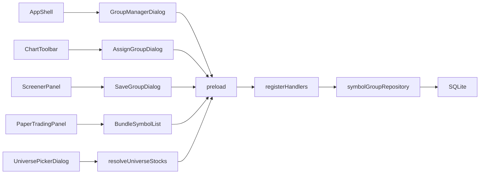

# Sprint9 迭代文档

> 版本：v0.3.9
> 状态：**进行中**
> 关联：[需求文档](./需求文档.md)、[Sprint8 迭代文档](../Sprint8/迭代文档.md)、[商流链](../../v0.2/release文档.md)

本迭代做自定义标的分组。分类、分组、分组成员分开存。侧栏打开分类管理弹框。图表范围菜单在指数行情、成分股、行业之后，按已建分类各加一个页签。图表上的分组按钮改为可用，把当前标的放进已有分组。选股命中可以存成一个分组。模拟盘模板在单个标的、一组标的之外，增加按分组加载标的池。

---

## 1. 当前迭代目标

用户可以建立分组分类和分组，维护分组里的标的，并在图表范围、图表工具栏、选股结果和模拟盘模板里使用这些分组。

### 1.1 目标声明

| # | 目标 | 验收口径 |
|---|---|---|
| G1 | 三层数据可增删改，名称可改，身份不跟着名称走 | 分类和分组各有独立 id；改名后图表范围、成员、模拟盘草稿仍指向原 id；删除分类后，其下分组还在，并出现在「未分类」 |
| G2 | 侧栏打开分类管理弹框 | 弹框左侧是功能区和目录树，右侧是当前分组的标的；「未分类」不能改名、不能删除；分类和分组的选中彼此分得开 |
| G3 | 图表能按分组看标的，也能把当前标的放进分组 | 每建一个分类，范围菜单在三个内置页签后多出一个同级页签；点分组后左列只剩该组成员；分组按钮打开可多选、可按名称过滤的树，保存前列出将放入的分组 |
| G4 | 选股结果能存成一个分组 | 有命中时才能保存；名称自动为 `日期_策略名`；要选分类，并能把该分类记为下次默认 |
| G5 | 模拟盘模板能加载一整个分组 | 标的选择增加「分组标的」；其下有「隐藏标的名称和代码」和一份可删行的标的列表；删行只缩本次模拟的标的池 |

### 1.2 范围边界（本迭代不做）

- 不改指数行情、成分股、行业的数据来源，也不在分类管理弹框里编辑这三类
- 不把「未分类」写成分类表里的一行，也不给它单独的图表页签
- 不在分类之间移动分组，不拖拽排序
- 不把买卖方向写进分组。选股保存只存标的
- 不改 `strategy.screen`、选股读数窗口和命中规则
- 选股页、模拟盘、数据页的图表工具栏仍不显示分组按钮
- 模拟盘列表里删掉的标的不回写分组表
- 不改「单个标的」「一组标的」现有规则。一组标的仍是 1 到 10 个，指定或随机
- 分组不进 Python worker，不新增行情同步

### 1.3 技术选型（本迭代）

| 层 | 选型 |
|---|---|
| 壳 / 构建 | 现有 Electron。管理、分配、保存都用弹框，不新增页面 |
| UI | MUI 对话框和目录树。图表范围继续用 `UniversePickerDialog` 的页签 |
| 业务 | 校验和写入放主进程仓库。页面提交 id、名称和代码 |
| 数据 / 计算 | 应用库 SQLite，三张新表。行情仍在 DuckDB，本迭代不读它 |
| 协议 | 新 IPC `symbolGroup.*`。模拟盘方案 JSON 增加一种标的数量，旧方案仍能读 |

---

## 2. 功能需求

### 2.1 用户故事

1. 作为用户，我在侧栏打开分类管理，创建分类和分组，给分组加入或删除标的。
2. 作为用户，我删掉一个分类后，里面的分组还在，并归到「未分类」。
3. 作为用户，我在图表范围里点开自己建的分类，左列变成该分组的标的。
4. 作为用户，我在图表上点分组，一次把当前标的放进多个已有分组，保存前能看到分组名称。
5. 作为用户，我选股之后把当天命中存成一个分组，名称带上日期和策略名，并记住默认分类。
6. 作为用户，我做模拟盘模板时选一个分组，列表载入全部成员；我可以划掉几只，也可以隐藏名称和代码。

### 2.2 功能清单

| ID | 功能 | 优先级 | 状态 |
|---|---|---|---|
| F01 | 分类、分组、成员三张表和仓库 | P0 | 已完成 |
| F02 | `symbolGroup.*` IPC 与预加载 | P0 | 已完成 |
| F03 | 侧栏入口和分类管理弹框 | P0 | 已完成 |
| F04 | 图表范围按分类展示分组，左列加载成员 | P0 | 已完成 |
| F05 | 图表分组按钮：多选、过滤、保存前提示 | P0 | 已完成 |
| F06 | 选股结果保存为分组，并记住默认分类 | P0 | 已完成 |
| F07 | 模拟盘模板「分组标的」 | P0 | 已完成 |

### 2.3 非功能需求

- 分类和分组用 id 标识。名称只用于显示，改名不改变 id
- 同一分类下分组名唯一。分类名在全表唯一。空名称拒绝。名称最长 40 字
- 分类名不能使用「未分类」「指数行情」「成分股」「行业」
- 删除分类、删除分组、改成员都在一个事务里完成
- 成员以 `ts_code` 去重。重复添加保持原行
- 管理弹框、分配弹框、选股保存各自只有一路提交。进行中按钮不可再次点击
- 已保存的模拟盘方案在没有新字段时，仍按现在的单个标的或一组标的读出

---

## 3. 详细设计说明

### 3.1 进程与数据流

分组是用户自己的名单，落在应用 SQLite。渲染进程经预加载调用主进程仓库。Python worker 不参与。

图表和数据页共用范围弹框。选中 `group:{分组 id}` 后，左列按成员表拼出标的。图表分组按钮改的是成员关系。选股保存是新建一个分组并写入当天命中。模拟盘「分组标的」读出成员后抄进方案草稿，之后删行只改草稿。



主路径：

1. 打开应用时 `initDb` 建好三张表。侧栏增加一个图标，点击只打开管理弹框，不切换页面。
2. 管理弹框拉取分类和分组。树上固定有「未分类」。未挂分类的分组放在它下面。
3. 图表范围在三个内置页签后追加用户分类。点开某个分组，左列换成该组成员。
4. 图表有当前标的时，分组按钮可点。弹框用勾选表示该标的现在属于哪些分组，保存前确认分组名称，再覆盖该标的的成员关系。
5. 选股有命中时，右栏出现保存。名称用信号日和策略名生成，用户选分类，可选「设为默认」。
6. 模拟盘模板选「分组标的」并指定一个分组后，列表载入全部成员。用户可删行、可隐藏名称和代码。开始模拟时用这份列表，不再从全市场随机抽取。

商流链上的分工：

| 环节 | 本迭代职责 |
|---|---|
| UI Controller | 管理弹框、范围页签、分组按钮、选股保存、模拟盘第三种标的 |
| Protocol | `symbolGroup.*` 读写三张表 |
| Chart | 左列继续用现有标的列表，只是数据来自组成员 |
| Script | 不改策略和选股计算 |

### 3.2 目录 / 模块（本迭代涉及）

```
src/main/db/sqlite.ts                         三张新表
src/main/db/symbolGroupRepository.ts
src/main/services/applicationService.ts
src/main/ipc/registerHandlers.ts
src/preload/index.ts
src/preload/index.d.ts
src/shared/types/symbolGroup.ts
src/shared/constants/chartUniverse.ts         group: 前缀
src/renderer/src/layout/AppShell.tsx          侧栏入口，不新增 AppPage
src/renderer/src/pages/groups/GroupManagerDialog.tsx
src/renderer/src/pages/groups/AssignGroupDialog.tsx
src/renderer/src/pages/groups/SaveGroupDialog.tsx
src/renderer/src/pages/chart/UniversePickerDialog.tsx
src/renderer/src/pages/chart/ChartToolbar.tsx 放开分组按钮
src/renderer/src/pages/ChartPage.tsx
src/renderer/src/pages/resolveUniverseStocks.ts
src/renderer/src/pages/screen/ScreenerPanel.tsx
src/renderer/src/pages/paper/PaperTradingPanel.tsx
src/shared/types/paperPlan.ts
src/shared/paper/paperPlan.ts                 旧方案仍能读
```

[`UniversePickerDialog`](../../../../src/renderer/src/pages/chart/UniversePickerDialog.tsx) 现有三个页签保持原样。数据页 [`MarketPage`](../../../../src/renderer/src/pages/MarketPage.tsx) 用的是同一个弹框和 [`resolveUniverseStocks`](../../../../src/renderer/src/pages/resolveUniverseStocks.ts)，因此也会看到新建分类。数据页其余行为不动。

[`ChartToolbar`](../../../../src/renderer/src/pages/chart/ChartToolbar.tsx) 里的分组按钮当前是禁用的。选股页和模拟盘通过 `showGroup` 把它藏掉，本迭代保持隐藏。

### 3.3 数据模型 / 存储

表建在 [`sqlite.ts`](../../../../src/main/db/sqlite.ts) 的 `MIGRATION_SQL` 里，随 `initDb` 的 `CREATE TABLE IF NOT EXISTS` 落到现有库。`foreign_keys` 已经打开。

| 表 | 作用 |
|---|---|
| `symbol_group_category` | 分组分类。一行一个分类 |
| `symbol_group` | 分组。`category_id` 为空表示未分类 |
| `symbol_group_member` | 分组中的标的 |

`symbol_group_category`：

| 列 | 说明 |
|---|---|
| `id` | 主键，`crypto.randomUUID()` |
| `name` | 显示名，全表唯一 |
| `is_default` | 0 或 1。全表最多一行是 1，用部分唯一索引卡住 |
| `sort_order` | 创建顺序，页签和目录树都按它排 |
| `created_at` / `updated_at` | ISO 时间 |

`symbol_group`：

| 列 | 说明 |
|---|---|
| `id` | 主键 |
| `category_id` | 可空，外键 `ON DELETE SET NULL` |
| `name` | 显示名 |
| `sort_order` | 同一分类内的创建顺序 |
| `created_at` / `updated_at` | ISO 时间 |

同一分类下分组名唯一，由仓库在写入前检查。未分类的 `category_id` 为空，SQLite 唯一索引不会把多个空值当成重复，所以未分类重名也要在仓库里查。

`symbol_group_member`：

| 列 | 说明 |
|---|---|
| `group_id` | 外键，分组删除时级联删除成员 |
| `ts_code` | 与 `group_id` 组成主键 |
| `name` | 加入时从本地股票列表抄下的名称 |
| `sort_order` | 加入顺序 |

删除分类时，先把该分类下分组的 `category_id` 置空，再删分类行。分组和成员保留。若删掉的是默认分类，默认标记一并消失，下次选股保存回到「未分类」。

删除分组时，成员随外键级联删除。

「未分类」只存在于界面。目录树在没有分类、或有分组的 `category_id` 为空时，都显示这个节点。

名称规则：

| 对象 | 规则 |
|---|---|
| 分类 | 去首尾空白后 1 到 40 字；不与已有分类重名；不能叫「未分类」「指数行情」「成分股」「行业」 |
| 分组 | 去首尾空白后 1 到 40 字；同一分类下不重名；未分类单独算一个范围 |
| 选股自动名 | `YYYY-MM-DD_策略名`。超长时截断策略名。该分类下已有同名时依次加 ` (2)`、` (3)` |

### 3.4 协议 / API / IPC

通道放在预加载的 `symbolGroup` 上，形状与现有 `paperPlan` 相同：渲染进程 `invoke`，主进程仓库执行，失败抛出中文原因。

| 通道 | 作用 |
|---|---|
| `symbolGroup.tree` | 返回分类、未分类分组、每个分组的成员数、默认分类 id |
| `symbolGroup.createCategory` | `{ name }` |
| `symbolGroup.renameCategory` | `{ id, name }` |
| `symbolGroup.deleteCategory` | `{ id }`。分组改为未分类 |
| `symbolGroup.createGroup` | `{ categoryId, name }`。`categoryId` 为空则建在未分类 |
| `symbolGroup.renameGroup` | `{ id, name }` |
| `symbolGroup.deleteGroup` | `{ id }` |
| `symbolGroup.members` | `{ groupId }`。按 `sort_order` 返回 `{ tsCode, name }` |
| `symbolGroup.addMembers` | `{ groupId, symbols }`。已在组内的代码跳过 |
| `symbolGroup.removeMembers` | `{ groupId, tsCodes }` |
| `symbolGroup.membership` | `{ tsCode }`。返回该标的所在分组 id |
| `symbolGroup.setSymbolGroups` | `{ tsCode, name, groupIds }`。该标的的成员关系改成这份 id 列表 |
| `symbolGroup.saveHits` | `{ name, categoryId, symbols, makeDefault }`。新建分组并写入成员；`makeDefault` 为真时把该分类标成默认，`categoryId` 为空则清掉默认 |

拒绝条件：名称为空、超长、重名、保留名、id 不存在、成员代码为空。`setSymbolGroups` 里出现未知分组 id 时整次拒绝，不写一半。

图表范围 id 使用 `group:{分组 id}`，加在 [`chartUniverse.ts`](../../../../src/shared/constants/chartUniverse.ts)。解析函数认这个前缀。认不出的 id 仍走现有分支。

[`resolveUniverseStocks`](../../../../src/renderer/src/pages/resolveUniverseStocks.ts) 在成分股解析之前处理 `group:`。现有实现遇到认不出的 id 会退回全部在市股票，分组 id 必须先被截住。成员能在在市列表里对上的，用列表里的股票行；对不上的，用成员表里的名称拼一行，避免退市或指数从分组里消失。

### 3.5 核心编排

分类管理：

1. `tree` 拉目录。分类按 `sort_order`，其下挂自己的分组。「未分类」节点始终在，下面挂 `category_id` 为空的分组。
2. 创建分类只插入分类行。创建分组时，功能选中落在某个分类上，就挂到该分类；落在「未分类」或某个未分类分组上，就挂到未分类；落在已分类分组上，就挂到该分组的同一分类。
3. 修改名称、删除作用在功能选中的节点。「未分类」这两项不可用。
4. 删除分类前确认「其下分组将变为未分类」。删除分组前确认连同成员一起删除。

图表分配：

1. 读 `membership`，把该标的已在的分组勾上。
2. 过滤器只匹配分组名。分类名对上时，展开并显示其下全部分组。没有命中的分类收起不显示。
3. 保存前确认框列出勾中的分组名。一个都没勾时，确认框写明将从已有分组移出。取消则不写库。
4. 确认后调用 `setSymbolGroups`。勾选结果就是该标的之后所属的全部分组。

选股保存：

1. 仅当本次 `hits` 非空且不在执行中时，右栏显示「保存为分组」。
2. 名称用月历上的 `YYYY-MM-DD` 加下划线加策略下拉里的名称。用户不手改名称。
3. 分类下拉含「未分类」和全部用户分类。缺省选中 `is_default = 1` 的分类；没有默认时选「未分类」。
4. 「设为默认分类」勾上时，`makeDefault` 为真。
5. 成员取命中列表的代码，名称从本地股票列表补齐。不写买或卖。

模拟盘「分组标的」：

1. `PaperSymbolCount` 增加 `bundle`。界面文案是「分组标的」，与现有「一组标的」并列，三者互斥。
2. 选定分组后调用 `members`，把结果抄进草稿的 `symbols`，并记下 `bundleGroupId`。
3. 列表支持删除行。删除只改草稿，不调用 `removeMembers`。
4. 「隐藏标的名称和代码」沿用现有 `hideSymbol`。开始模拟时，`bundle` 且勾选隐藏，就对左列遮住名称和代码。
5. 开始模拟时直接使用这份 `symbols`，不走「一组标的」的数量上限，也不从全市场随机抽。列表被删空时不能开始。
6. 分组日后在库里的变化不改已经抄进草稿的列表。要更新，需重新选择该分组。
7. [`readPaperPlanDraft`](../../../../src/shared/paper/paperPlan.ts) 接受 `bundle`。旧方案没有 `bundleGroupId` 时，`symbolCount` 仍按 `single` 或 `group` 读出，`bundleGroupId` 为空。

### 3.6 UI

侧栏在「配置」上方增加分类管理图标。点击打开弹框。当前页面不变。

管理弹框约 880×560。左侧约 300，右侧余下。

左侧两段：

1. 功能区四个按钮：创建分类、创建分组、修改名称、删除。名称用弹框里的输入框，不用浏览器原生提示。
2. 目录树。分类节点下是分组。「未分类」固定在最前。

选中分成两个状态：

| 状态 | 谁可以成为目标 | 效果 |
|---|---|---|
| 功能选中 | 分类、分组、「未分类」 | 决定四个按钮作用在谁身上 |
| 内容选中 | 只有分组 | 右侧换成该分组的标的列表 |

点分类时，功能选中改为该分类，右侧换成该分类的说明，不出现标的列表。点分组时，两个状态都改为该分组。分类行和分组行的选中样式不同，避免把「按钮正作用在分类上」看成「右侧正在管这个分组」。

「未分类」可以功能选中。创建分组可用，修改名称和删除不可用。点它时右侧说明这些分组还没有分类。

右侧在内容选中为分组时分成两段：

1. 功能区：标的搜索框，选中后加入该分组；「全选」切换当前列表的勾选；「删除」去掉已勾选的行。没有勾选时删除不可用。
2. 列表：每行一个勾选框和标的名称，不显示代码。空分组写「该分组还没有标的」。

加载失败时，弹框写出原因，树和列表保持上一次成功的内容。

图表范围弹框的页签顺序是：指数行情、成分股、行业，然后按 `sort_order` 排用户分类。分类页里是该分类下的分组，点分组即选中 `group:{id}` 并关闭弹框。空分类写「该分类还没有分组」。左列没有成员时，提示「该分组还没有标的」。

图表分组按钮在当前图有标的时可点，没有标的时仍禁用。弹框含名称过滤器和带勾选框的分类树，底部是保存和取消。

选股右栏在执行按钮下增加「保存为分组」。没有命中、正在选股、或上次执行失败且没有可保存的命中时，按钮不可用。保存弹框展示自动名称、分类选择和「设为默认分类」。

模拟盘「标的选择」增加第三个选项「分组标的」。选中后出现分组选择、「隐藏标的名称和代码」和成员列表。列表每行有删除。模板摘要里这一档写成「分组标的」加分组名和剩余只数。现有「单个标的」「一组标的」的控件在这一档下不显示。

### 3.7 契约

| 层级 | 位置 |
|---|---|
| TypeScript | `src/shared/types/symbolGroup.ts`；`paperPlan.ts` 增加 `bundle` |
| 主进程 | `src/main/db/symbolGroupRepository.ts` |
| JSON Schema | 本迭代不单建 schema 文件，校验放在仓库里 |
| Python | 不改 |

---

## 4. 任务步骤

| 步骤 | 任务 | 产出 | 状态 |
|---|---|---|---|
| 1 | 三张表、名称校验、删除分类只解除关联 | `sqlite.ts`、`symbolGroupRepository.ts` | 已完成 |
| 2 | 主进程分发、IPC 和预加载 | `symbolGroup.*` | 已完成 |
| 3 | 侧栏入口和管理弹框，区分功能选中与内容选中 | `GroupManagerDialog` | 已完成 |
| 4 | 范围页签和 `group:` 列表 | `UniversePickerDialog`、`resolveUniverseStocks` | 已完成 |
| 5 | 放开图表分组按钮，多选保存前提示 | `AssignGroupDialog`、`ChartToolbar` | 已完成 |
| 6 | 选股命中保存，默认分类 | `SaveGroupDialog`、`ScreenerPanel` | 已完成 |
| 7 | 模拟盘「分组标的」，旧方案仍能读 | `paperPlan.ts`、`PaperTradingPanel` | 已完成 |

### 4.1 本地复现命令

```bash
npm run typecheck
npm run dev
```

页面验收走开发窗口里的分类管理、图表、选股和模拟盘。本迭代开始时还没有对应的 acceptance 脚本。

---

## 5. 测试结果 / 总结反馈

### 5.1 验收清单与结果

| 检查项 | 方式 | 结果 | 说明 |
|---|---|---|---|
| G1 三层表、改名、删除分类留分组 | 手工 | 待补跑 | 表和仓库已接上，窗口里还没点过 |
| G2 管理弹框与「未分类」 | 手工 | 待补跑 | 弹框已接上，窗口里还没点过 |
| G3 范围页签、左列成员、分组按钮 | 手工 | 待补跑 | 窗口里还没点过 |
| G4 选股保存与默认分类 | 手工 | 待补跑 | 窗口里还没点过 |
| G5 模拟盘分组标的、删行不回写、隐藏名称 | 手工 | 待补跑 | 窗口里还没点过 |
| 旧模拟盘方案仍能打开 | 手工 | 待补跑 | 解析已放宽，窗口里还没打开旧方案 |
| 类型检查 | 脚本 | 通过 | 2026-10-30，`npm run typecheck` 退出码 0 |

### 5.2 关键命令记录

```
2026-10-30  npm run typecheck
typecheck:node  退出码 0
typecheck:web   退出码 0
```

### 5.3 总结反馈

**做得好的地方**

- 需求把分组收成分类、分组、标的三层，并写明删除分类只删关联、名称不能当 id
- 四个使用点都接在现成入口上：范围弹框的页签、图表上已留的分组按钮、选股右栏、模拟盘标的选择

**暴露的问题 / 摩擦**

- 需求写了「批量操作按钮」，没有列出具体动作。本文收成列表多选、「全选」和「删除」
- 需求写了一次分配到多个组，没有写取消勾选是否移出。本文把弹框勾选当作该标的的完整成员关系，保存前把分组名列出来
- 「未分类」若也做成图表页签，就和「每建一个分类多一个页签」叠在一起。本文只在管理树里保留它
- 图表和数据页共用范围弹框。分组页签会出现在数据页，这是同一组件的结果
- `resolveUniverseStocks` 对认不出的范围 id 会列出全部在市股票。`group:` 已放在成分股解析之前
- 现有「一组标的」最多 10 个。分组标的使用成员快照，开始模拟时不套这个上限
- 旧方案没有 `bundle` 字段时仍按原来的单个或一组标的读出
- 需求没有「把分组改挂到另一个分类」。建错分类时，本迭代只能删掉重建。这一项放到下一轮
- 分类管理、图表、选股和模拟盘这几条路径还没有在开发窗口里点过

---

## 6. 改进目标

### 6.1 短期（下一迭代可做）

1. 允许把分组改挂到另一个分类，或挂回未分类
2. 分类管理里可以直接指定默认分类，不必等一次选股保存
3. 选股自动名允许手改，重名时给出明确提示
4. 为仓库补一条可重复跑的检查：删分类后分组仍在、同名被拒绝、成员去重

### 6.2 中期

1. 「未分类」也能作为图表范围页签
2. 目录树支持拖拽排序和跨分类移动
3. 模拟盘打开模板时，若分组成员已经变化，提示是否用库里的新列表替换草稿

### 6.3 长期

1. 分组既可以是手工名单，也可以按行业、成分或选股条件自动更新
2. 交易管理把分组当作观察池，和图表、模拟盘共用同一份成员

---

## 附录

### A. 相关文档

- [需求文档](./需求文档.md)
- [Sprint8 迭代文档](../Sprint8/迭代文档.md)
- [商流链](../../v0.2/release文档.md)

### B. 常用命令

| 命令 | 用途 |
|---|---|
| `npm run dev` | 开发起窗 |
| `npm run typecheck` | 主进程与渲染进程类型检查 |
